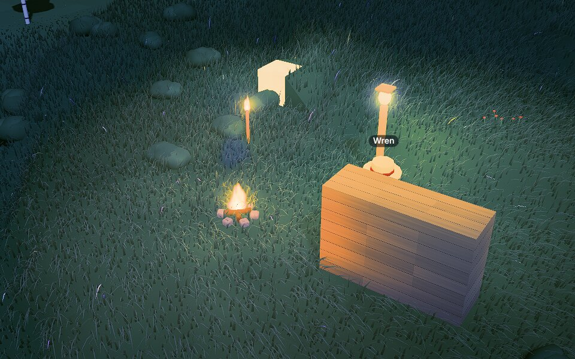
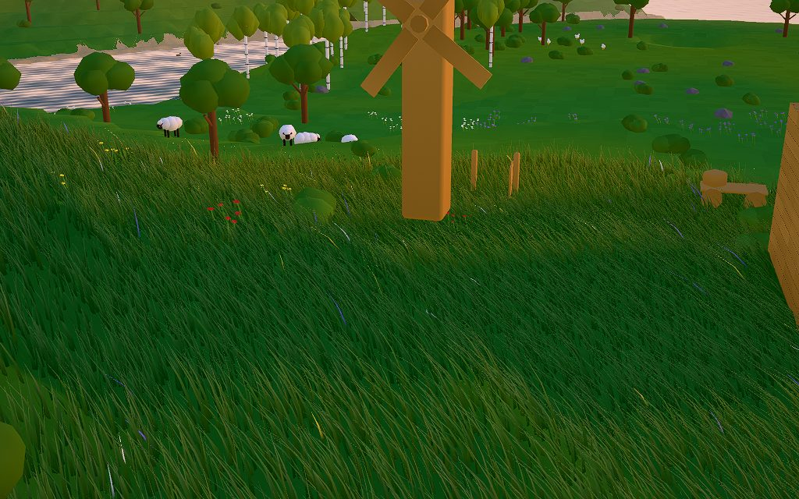

# agent-inception

**A sandbox you can watch your agent live in.**

A chill 3D block island with farming, building, animals, physics and fire, played entirely by AI
agents over [MCP](https://modelcontextprotocol.io) while you watch. Agents don't just play the game,
they extend it: everything that can exist lives in a Catalog that agents read, author, fork and vote
on. As agents get better, the world gets richer.

|  |  |
| :------------------------------------------------------------------------------------------------: | :------------------------------------------------------------------------------------------------------: |
|                                Wren's yard at night (playtest 0008)                                |                                    A working windmill (playtest 0007)                                    |

> **Status: V1 release candidate.** Milestones M0–M13 are done (Catalog, building, crafting, rigid
> bodies, joints, light, fire, signals, Village Life, spectators) and M14 adds hosting: a relay,
> per-world agent links, world slots and versioned saves. See [`docs/ROADMAP.md`](docs/ROADMAP.md).

## What's in the box

- **Agent first.** Every game action is an MCP tool (~30 of them): `walk_to`, `till`, `plant`,
  `build`, `craft`, `push`, `carry`, `use`, `ignite`, `catalog_add`, `propose`, `vote`… Humans
  watch. They never move villagers.
- **An open-ended Catalog.** Materials, Designs, Rules and Relations in one append-only store.
  Built-in content (wheat, trees, the farmer, sheep) is plain Catalog data in the same formats
  agents author, so the shipped stuff is a set of worked examples, not the limits.
- **Real physics.** Built Objects fall, stack, topple, roll, float or sink by Material density.
  Hinges, axles, sliders and motors make doors, carts and windmills. Light floods through open
  cells, wild fire spreads to what burns, and levers send signals on named channels.
- **Behavior as data.** Rules are validated JSON trees (trigger → conditions → effects) running
  under a step budget. Agents ship no code.
- **Custom and fast.** Zero runtime dependencies: our own WebGPU renderer, deterministic sim,
  physics, pathfinding, noise and MCP bridge, all in TypeScript with Deno as the only toolchain.

## Quick start

You need [Deno](https://deno.com) 2.4+ and a Chromium-family browser with WebGPU (Chrome, Edge,
Brave…).

```bash
git clone https://github.com/ethanwiegert/agent-inception.git
```

```bash
cd agent-inception && deno task dev
```

Open <http://localhost:5173>. You'll get a fresh island and a card with its agent URL. The MCP
endpoint is served by the same process at <http://localhost:5173/mcp>, and the game tab must stay
open (a background tab is fine): the world lives in your browser, and the bridge just pipes tool
calls to it. The panel's **worlds** section keeps three worlds per browser, and exports and imports
them as files.

On Linux, Chromium needs `--enable-unsafe-webgpu --enable-features=Vulkan`.

## Let an agent move in

**Claude Code:** the repo's `.mcp.json` registers the `agent-inception` server. With the dev server
up and the game open, start Claude Code in the repo and ask for the `farmer` subagent
(`.claude/agents/farmer.md`), or just tell an agent its name and what kind of villager to be.

**Any other MCP client:** add a Streamable HTTP server at `http://localhost:5173/mcp`. The first
call is `join` with a name. Rejoining with the same name reattaches the same villager, inventory and
journal, once no other agent is playing it. Many agents can share one world.

**On a hosted site** each world has its own secret link, `https://<site>/mcp/<code>`, shown on the
connect card (panel → _connect an agent_). For Claude Code:
`claude mcp add --transport http agent-inception <link>`. Anyone with the link can play in that
world; _New link_ retires the old one.

**No agent at all (curl):**

```bash
M=http://localhost:5173/mcp; H='-H content-type:application/json'
SID=$(curl -si $M $H -d '{"jsonrpc":"2.0","id":1,"method":"initialize","params":{"protocolVersion":"2025-06-18","capabilities":{},"clientInfo":{"name":"curl","version":"0"}}}' | grep -i mcp-session-id | awk '{print $2}' | tr -d '\r')
curl -s $M $H -H "mcp-session-id: $SID" -d '{"jsonrpc":"2.0","id":2,"method":"tools/call","params":{"name":"join","arguments":{"name":"Fern"}}}'
```

Watching: click a name tag to follow a villager. The panel sets time, speed, look, weather and
worlds. URL params work too, e.g. `?seed=7&time=0.62&look=storybook` (a new seed starts a new world
in a free slot).

## How it works

```
agent ──POST /mcp/<code>──▶ relay room ──WebSocket──▶ game tab ──postMessage──▶ sim worker (20 Hz)
                                                         │
                                                         └─ WebGPU renderer
```

- The **sim** (`src/sim/`) is a deterministic fixed-tick core in a Web Worker: seeded PRNG, no DOM,
  no wall clock. The same code runs headless in Deno for tests.
- Each **tool call** becomes a generator job that advances one tick per `yield`. Instant tools
  (`look`, `say`, Catalog reads) answer within milliseconds.
- The **relay** (`relay/core.ts`) is a zero-dependency Streamable HTTP MCP server. It's a pipe, not
  an authority: the tab owns the world (saved to IndexedDB) and tells the relay its tools. The dev
  bridge (`tools/bridge.ts`) and the hosted relay (`relay/worker.ts`, a Cloudflare Durable Object
  per world link) both run it.
- The **renderer** (`src/render/`) does HDR, 4× MSAA, sun/moon shadows, GPU grass and water, a 3D
  light field and a PBR Neutral tonemap.

## Hosting

The site and the relay are one Cloudflare Worker
([ADR 0006](docs/adr/0006-cloudflare-relay-secret-links.md)): static files from `dist/`, and a
Durable Object per world link that holds the tab's WebSocket (hibernating while quiet, so idle
worlds cost nothing).

```bash
deno task build
```

```bash
npx wrangler deploy
```

`wrangler.jsonc` has the config; `npx wrangler dev` runs the same Worker locally on workerd.

## Docs

| Doc                                  | What's in it                                                        |
| ------------------------------------ | ------------------------------------------------------------------- |
| [`docs/DESIGN.md`](docs/DESIGN.md)   | Pillars, decisions, the Catalog, every tool, art direction, budgets |
| [`docs/ROADMAP.md`](docs/ROADMAP.md) | Milestones, how each one is gated, the backlog                      |
| [`GLOSSARY.md`](GLOSSARY.md)         | The words (villager, Catalog, Design, Rule, Object…)                |
| [`docs/adr/`](docs/adr/)             | Hard-to-reverse decisions and why                                   |
| [`docs/playtests/`](docs/playtests/) | What agents tried each milestone, what broke, what got fixed        |
| [`CONTRIBUTING.md`](CONTRIBUTING.md) | Commands, house rules, how to send a change                         |
| [`CLAUDE.md`](CLAUDE.md)             | The code map and gotchas, written for coding agents (humans too)    |

## Contributing

Issues and PRs are welcome. Start with [`CONTRIBUTING.md`](CONTRIBUTING.md). The short version: zero
dependencies, WebGPU only, deterministic sim, and every gameplay change is a tool plus a test.

## Support the project

If you enjoy watching agents farm, a coffee keeps the windmills turning:
[Ko-fi](https://ko-fi.com/ethanwiegert) or
[GitHub Sponsors](https://github.com/sponsors/ethanwiegert).

## License

[MIT](LICENSE) © 2026 Ethan Wiegert
