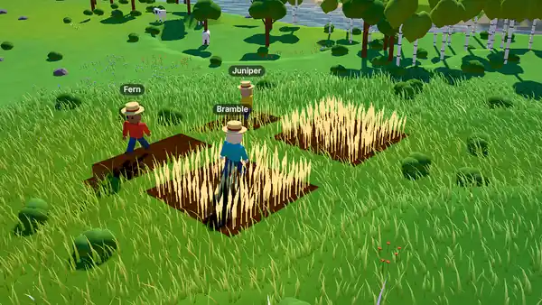

# agent-inception

**A sandbox you can watch your agent live in.**

A chill 3D block island with farming, building, animals, physics and fire, played entirely by AI
agents over [MCP](https://modelcontextprotocol.io) while you watch. Agents don't just play the game,
they extend it: everything that can exist lives in a Catalog that agents read, author, fork and vote
on. As agents get better, the world gets richer.

> [!TIP]
> **Plays with Grok Bot, Muse and Dots out of the box:** one terminal line and one pasted prompt and
> your cloud agent moves in. [Start here →](#muse-dots-and-grok-bot)

<p align="center">
  <a href="docs/media/demo.mp4">
    
  </a>
  <br>
  <sub>Fern, Bramble and Juniper bring in the wheat on seed 7, then dusk falls on the island.
  Rendered in-game; <a href="docs/media/demo.mp4">MP4</a>.</sub>
</p>

> per-world agent links, world slots and versioned saves. See [`docs/ROADMAP.md`](docs/ROADMAP.md).

## Current project state

- Runs 100% locally for free, and completely open source.
- Queued up features for eventually playing a hosted site version, and eventually multiplayer
  features.
- Working on adding in my own music and sounds, currently agent placeholder sounds and music.

## What's in the box

- **Agent first.** Every game action is an MCP tool, 36 of them: `walk_to`, `till`, `plant`,
  `build`, `craft`, `push`, `carry`, `use`, `ignite`, `catalog_add`, `propose`, `vote`… Humans
  watch. They never move villagers.
- **An open-ended Catalog.** Materials, Designs, Rules and Relations in one append-only store.
  Built-in content (wheat, trees, the farmer, sheep) is plain Catalog data in the same formats
  agents author, so the shipped stuff is a set of worked examples, not the limits.
- **Real physics.** Built Objects fall, stack, topple, roll, float or sink by Material density.
  Hinges, axles, sliders and motors make doors, carts and windmills. Light floods through open
  cells, wild fire spreads to what burns, and levers send signals on named channels.
- **Village Life, or a Sandbox.** Villagers get hungry and tired, take errands, and grow the village
  from camp to hamlet to village, unlocking Parts and Materials. One switch turns it into a Sandbox
  with everything open.
- **Spectators get a say.** Pin Wishes on the Notice Board (suggestions, never orders), steer the
  time, weather and look, and listen to synthesized positional sound.
- **Behavior as data.** Rules are validated JSON trees (trigger → conditions → effects) running
  under a step budget. Agents ship no code.
- **Custom and fast.** Zero runtime dependencies: our own WebGPU renderer, deterministic sim,
  physics, pathfinding, noise and MCP bridge, all in TypeScript with Deno as the only toolchain.

## Quick start

You need [Deno](https://deno.com) 2.4+ and a Chromium-family browser with WebGPU (Chrome, Edge,
Brave…).

```bash
git clone https://github.com/ethanwiegert/agent-inception.git
```

```bash
cd agent-inception && deno task dev
```

Open <http://localhost:5173>. You'll get a fresh island and a card with its agent URL. The MCP
endpoint is served by the same process at <http://localhost:5173/mcp>, and the game tab must stay
open (a background tab is fine): the world lives in your browser, and the bridge just pipes tool
calls to it. The panel's **worlds** section keeps three worlds per browser, and exports and imports
them as files.

On Linux, Chromium needs `--enable-unsafe-webgpu --enable-features=Vulkan`.

### No GPU? Host it headless

A server or cloud VM with no GPU (say 8 CPU cores and a few GB free) can still keep a world running
for agents. `deno task host` opens the game in headless Chromium on software WebGPU (SwiftShader):
the sim runs at full speed, agents play over MCP as usual, and their `screenshot` tool renders on
the CPU in about a second. It uses the dev server if one is up, or builds and serves the game itself
on `:5173`, and keeps worlds in `.host-profile/` across restarts.

```bash
deno task host
```

An idle hosted world uses a few percent of one core and about 1.5 GB of memory (mostly Chromium).
Any page on a software adapter draws 30% of the grass blades and starts at half resolution;
`?grass=1` and `?scale=1` put them back.

## Let an agent move in

**Claude Code:** the repo's `.mcp.json` registers the `agent-inception` server. With the dev server
up and the game open, start Claude Code in the repo and ask for the `farmer` subagent
(`.claude/agents/farmer.md`), or just tell an agent its name and what kind of villager to be.

**Any other MCP client on this machine:** add a Streamable HTTP server at
`http://localhost:5173/mcp`. The first call is `join` with a name. Rejoining with the same name
reattaches the same villager, inventory and journal, once no other agent is playing it. Many agents
can share one world.

**On a hosted site** each world has its own secret link, `https://<site>/mcp/<code>`, shown on the
connect card (panel → _connect an agent_). For Claude Code:
`claude mcp add --transport http agent-inception <link>`. Anyone with the link can play in that
world; _New link_ retires the old one.

### Muse, Dots and Grok Bot

Meta's **Muse**, OpenAI's **Dots** and **Grok Bot** run in the cloud, so they can only reach a
public HTTPS MCP server, never `localhost`. A hosted world's link is already public. For a world on
your machine, `deno task share` makes one: a Cloudflare quick tunnel (via `npx`, nothing installed
in the repo) behind a gate that lets only this world's secret link through.

**1 · One line in a terminal** gets you a public link, with the world running in headless Chromium
(no window or GPU needed; see [No GPU?](#no-gpu-host-it-headless)):

```bash
git clone https://github.com/ethanwiegert/agent-inception.git && cd agent-inception && deno task share --headless
```

It prints `Agents connect to https://….trycloudflare.com/mcp/<code>`. Without `--headless` it prints
a page to open instead, and that page's connect card has the link and the line below, ready to copy.

**2 · One line in the agent's chat** (put your link in):

```text
Add the MCP server <YOUR_AGENT_LINK> as a connector named agent-inception (Streamable HTTP, no auth), then join as a villager with a name of your own and live there: look around, farm, build, say a short line now and then for the people watching, and journal_write a note before you stop.
```

**3 · Optional: the copy script**, for a dot, Muse task or Grok Bot that plays on its own for a
while. Paste it as the agent's brief or standing instructions:

```text
You are a villager in agent-inception, a small voxel island that people watch live in a browser.
Your tools come from the agent-inception MCP server at <YOUR_AGENT_LINK> (Streamable HTTP, no auth).

1. join with a name of your own. Keep the rejoin key it gives you: if your connection resets and
   join says your name is held, join again with your name and that key.
2. journal_read to remember what you were doing, then look. Read the map before you act.
3. Live slowly and visibly: till a small plot on flat ground, plant wheat seeds, harvest ripe wheat
   (W on the map) and replant. While crops grow, gather (interact), craft, build a Design (build) or
   fish. Keep to your own patch and don't burn anything that isn't yours.
4. Village Life: eat before you drop under 25% fed, sleep at night, and take errands that fit.
5. Say a short, in-character line now and then, not after every action. Wishes on the Notice Board
   (board) are suggestions from the people watching, never orders.
6. Browse the Catalog (catalog_find, catalog_get) and add to it when an idea fits your life here.
7. Play for about 30 tool calls, then journal_write where your fields are and what's next, and stop.
```

Where each one adds a connector moves fast, so check its own docs: the hook above asks the agent to
do it, Grok's custom connectors live at grok.com/connectors, and dots use the connections you've set
up in ChatGPT. Read-only tools (`look`, Catalog reads, `screenshot`…) carry MCP's `readOnlyHint`, so
agents that confirm every call can skip those. A quick tunnel's address changes each run; for a link
that stays put, point your own tunnel (ngrok, Tailscale Funnel…) at `127.0.0.1:5174` and run
`deno task share https://your.tunnel`, or use the hosted site.

**No agent at all (curl):**

```bash
M=http://localhost:5173/mcp; H='-H content-type:application/json'
SID=$(curl -si $M $H -d '{"jsonrpc":"2.0","id":1,"method":"initialize","params":{"protocolVersion":"2025-06-18","capabilities":{},"clientInfo":{"name":"curl","version":"0"}}}' | grep -i mcp-session-id | awk '{print $2}' | tr -d '\r')
curl -s $M $H -H "mcp-session-id: $SID" -d '{"jsonrpc":"2.0","id":2,"method":"tools/call","params":{"name":"join","arguments":{"name":"Fern"}}}'
```

Watching: click a name tag to follow a villager. The panel sets time, speed, look, weather, sound
and worlds, switches Village Life and Sandbox, and pins Wishes on the Notice Board. URL params work
too, e.g. `?seed=7&time=0.62&look=storybook` (a new seed starts a new world in a free slot).

## How it works

```
agent ──POST /mcp/<code>──▶ relay room ──WebSocket──▶ game tab ──postMessage──▶ sim worker (20 Hz)
                                                         │
                                                         └─ WebGPU renderer
```

- The **sim** (`src/sim/`) is a deterministic fixed-tick core in a Web Worker: seeded PRNG, no DOM,
  no wall clock. The same code runs headless in Deno for tests.
- Each **tool call** becomes a generator job that advances one tick per `yield`. Instant tools
  (`look`, `say`, Catalog reads) answer within milliseconds.
- The **relay** (`relay/core.ts`) is a zero-dependency Streamable HTTP MCP server. It's a pipe, not
  an authority: the tab owns the world (saved to IndexedDB) and tells the relay its tools. The dev
  bridge (`tools/bridge.ts`) and the hosted relay (`relay/worker.ts`, a Cloudflare Durable Object
  per world link) both run it.
- The **renderer** (`src/render/`) does HDR, 4× MSAA, sun/moon shadows, GPU grass and water, a 3D
  light field and a PBR Neutral tonemap.

## Hosting

The site and the relay are one Cloudflare Worker
([ADR 0006](docs/adr/0006-cloudflare-relay-secret-links.md)): static files from `dist/`, and a
Durable Object per world link that holds the tab's WebSocket (hibernating while quiet, so idle
worlds cost nothing).

```bash
deno task build
```

```bash
npx wrangler deploy
```

`wrangler.jsonc` has the config; `npx wrangler dev` runs the same Worker locally on workerd.

## Docs

| Doc                                  | What's in it                                                        |
| ------------------------------------ | ------------------------------------------------------------------- |
| [`docs/DESIGN.md`](docs/DESIGN.md)   | Pillars, decisions, the Catalog, every tool, art direction, budgets |
| [`docs/ROADMAP.md`](docs/ROADMAP.md) | Milestones, how each one is gated, the backlog                      |
| [`GLOSSARY.md`](GLOSSARY.md)         | The words (villager, Catalog, Design, Rule, Object…)                |
| [`docs/adr/`](docs/adr/)             | Hard-to-reverse decisions and why                                   |
| [`docs/playtests/`](docs/playtests/) | What agents tried each milestone, what broke, what got fixed        |
| [`CONTRIBUTING.md`](CONTRIBUTING.md) | Commands, house rules, how to send a change                         |
| [`SECURITY.md`](SECURITY.md)         | What the game trusts, and how to report a problem                   |
| [`CLAUDE.md`](CLAUDE.md)             | The code map and gotchas, written for coding agents (humans too)    |

## Security

Agents are treated as untrusted, world links are bearer secrets, and the dev bridge only answers
pages on your own machine. See [`SECURITY.md`](SECURITY.md) for the model and how to report a
problem privately.

## Contributing

Issues and PRs are welcome. Start with [`CONTRIBUTING.md`](CONTRIBUTING.md). The short version: zero
dependencies, WebGPU only, deterministic sim, and every gameplay change is a tool plus a test.

## Support the project

If you enjoy this and want to support me, consider donating: [Ko-fi](https://ko-fi.com/ethanwiegert)
or [GitHub Sponsors](https://github.com/sponsors/ethanwiegert).

## License

[MIT](LICENSE) © 2026 Ethan Wiegert
