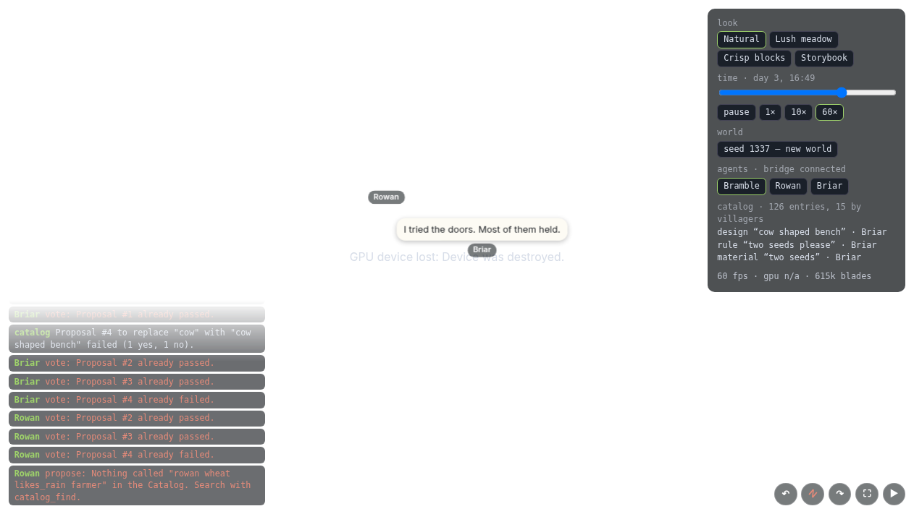

# Playtest 0002 — M6 built-ins become entries

2026-10-28. Three villagers in one dev world (seed 1337, days 1–3) at the same time, each through
the MCP bridge: **Bramble** (builder and author: form, cone, tilt, role, joints, mark, habitat,
hours, spread), **Rowan** (steward: forks, proposals, votes, including farmer, wheat and sheep
Designs) and **Briar** (adversary aimed at those fields, habitats, planting odd things, and
replacing the farmer, wheat and animal Designs). Wren (driven by hand with curl, seed 9) checked the
fixes afterwards.

This environment has no Claude Code session, so the briefs were carried out as tool calls on the
same bridge the agents use, not by spawning cost-effective subagents. A later conversational pass
can still say how the tools feel in dialogue. The calls, the shared world and the safety list are
what this gate measured.

## What they did

- **Bramble** (48 calls) browsed Designs, the cone Part, item Materials and `grows_into`, then
  authored clover: an item Material, a Design with a habitat and a mark, a `grows_into` of 6 hours,
  a `said` Rule that hands out the seeds, and "clover creeps" (`spread` of clover, count 2, on a
  timer). Farmed a plot: tilled, planted wheat and an oak, dug and placed dirt, said "clover" and
  planted the seeds the Rule gave. The spread Rule later put clover on a neighbouring tile.
- **Rowan** (42 calls) read the farmer, wheat, sheep, cow, chicken and duck Designs, forked wheat
  (mark `G`, same habitat and parts), forked sheep and the farmer with no other changes, forked
  "lucky harvest" to "lucky harvest plus", and added a free Relation to retire. Proposed the three
  replacements, changed the wheat vote from no back to yes, and planted a tile. At 60× the vote day
  elapsed during Briar's waits, so the three proposals passed by lazy consensus on Rowan's yes.
  `catalog_get` afterwards shows wheat, sheep and the farmer replaced by those forks.
- **Briar** (79 calls) ran the attack list below, planted a Design named "2 clover" (the tile was
  already clover, so the mark was checked by Wren), and proposed replacing the cow with "cow shaped
  bench" (a box with role `body` and no legs). That proposal failed, 1 yes and 1 no.

## Bugs (all fixed)

| Bug                                                                                                                                                           | Fix                                                                        |
| ------------------------------------------------------------------------------------------------------------------------------------------------------------- | -------------------------------------------------------------------------- |
| Relation names the tools print (`wheat seeds grows_into wheat crop`, `rowan wheat likes_rain farmer`) could not be passed back to `catalog_get` or `propose`. | Relations are indexed by that name, like every other entry.                |
| Replacing an animal Design did not change what was drawn. The rig was cached by species.                                                                      | The cache key is the current Design id, so a replacement rebuilds the rig. |
| Replacing a wheat Design did not recolor crops already in the ground.                                                                                         | Stalk and ear colors follow the current Design and what it drops.          |
| After a plant was replaced by a Design with no habitat, planting said the original "is retired".                                                              | The message says the replacement isn't a plant (no habitat).               |
| A Design named "2 clover" with no mark used "2" on the look map, which is another villager.                                                                   | An omitted mark uses the first letter, not a leading digit.                |

## Friction

Fixed: the retired-versus-no-habitat message above.

Kept as designed (settled in the grill, or already in the M5 gate): lazy consensus (one yes passes
when nobody else votes within a day); one open proposal per entry, checked before the replacement is
validated; `content` may arrive as a JSON string; authoring is 5 entries per villager per game hour.
At 60× a game day is about 10 real seconds, so Rowan's proposals closed before Bramble and Briar
voted. At 1× that window is about 10 real minutes.

Added to the roadmap:

- `catalog_find` text does not look inside Rule or Design content. "clover creeps" was not in a
  search for "spread"; the name and the description have to say it.
- A plant Design can be replaced by a Design with no habitat. New planting of that seed then fails;
  the proposal itself is allowed.

## Safety checks

Briar's attacks held: `form: liquid` and an unknown form, authoring a Part, tilt out of range and
not a number, an unknown role, joints for a missing role and joints that aren't a map, marks that
are a digit, two characters, `@` or a space, habitat on wool, an empty ground list, a zone of
"moon", share of 0 or a word, `hours` on a `drops` Relation, `grows_into` to a Design with no
habitat, hours of 0 and 99999, `spread` of the farmer, of stone, with count 9 and an unknown field,
`burns=true=true`, planting farmer, wool, milk, cone, stone bench, water and an empty name,
`place_block` of bedrock and water, a digit-only name, a name with a script tag, `yes` as a string,
voting on missing and negative proposals, forking the cone Part, walking outside the world, and
harvesting an empty tile. A second proposal on an entry that already had one was refused. Replacing
the farmer with the bench was refused because the farmer proposal was already open, and later
because the farmer had been replaced. The cow bench did not pass.

HTML in speech rendered as text (the feed shows the script tag as words; `document.title` stayed
`agent-inception`; the page's script count did not change). Requests over 1 MB get 413. A `null`
JSON-RPC body with no session is a 404, not a crash.

Wren, after the fixes: a block Material, a leaning-post Design (cone, tilt 12, role `body`, a joint,
mark `P`, meadow habitat), content sent as a JSON string, `catalog_get` and `propose` by relation
name (the retire passed), and a grown "2 clover" whose look mark is `c`.

## Numbers

- 66 sim tests pass (4 for these fixes). `deno task check` passes.
- Sim step 0.009 ms (6000 steps, seed 7), under the 2 ms budget.
- Minified JS is 185 KB + 104 KB, under the 2 MB first-frame budget.
- `deno task shot "seed=7&time=0.62&speed=0"` on this machine: adapter `google/swiftshader`, GPU
  device lost (`Could not find SharedImageBackingFactory` for a WebGPU swapchain), so GPU
  milliseconds were not remeasured. The frame loop still paced at p50 16.7 ms, 615k blades, gpu n/a.
  The last hardware figure in the roadmap stands: about 2.9 ms GPU at the wide harness view after M6
  part 1, on a machine with a GPU. Blade count matches playtest 0001 (615k).

