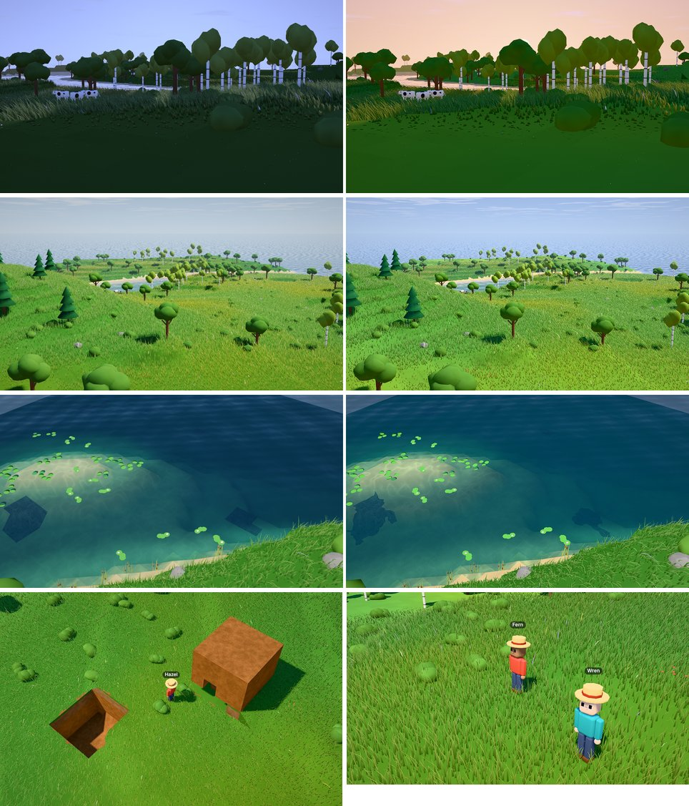

# Playtest 0003 — overhaul: efficiency, agent fluidity, looks

2026-10-28. Ethan asked for the project to run more efficiently, be more fluid for agents to
interact and build in, and look crisp and beautiful. This is not a milestone (M6's hardware GPU
remeasure is still open), so there was no grill. Building tools that M7's starting plan already
described came forward, and the rest of M7 (craft, interact, Parts in `build`, physics) waits for
its grill.

This cloud VM has no GPU and no display, and the session had no MCP connection for subagents. So:

- Every picture here comes from **headless Chromium on SwiftShader**, read back through the new
  offscreen capture. Every millisecond labelled "software" is CPU emulation: compare them with each
  other, never with the hardware budgets. Hardware numbers are still to come (see the end).
- Agents were driven over the real MCP bridge with a small script (the way playtest 0002 did), not
  by spawning cost-effective subagents.

## What changed

**Efficiency**

| What                              | Before                                                            | After                                                                                          |
| --------------------------------- | ----------------------------------------------------------------- | ---------------------------------------------------------------------------------------------- |
| `generateWorld` (seed 7, this VM) | 545 ms                                                            | ~140-165 ms, bit-identical (block, height, water, props hashes for seeds 1, 7, 1337 unchanged) |
| `new Sim`                         | 670 ms                                                            | 158 ms                                                                                         |
| `deno task test`                  | 44 s (66 tests)                                                   | 12-14 s (75 tests)                                                                             |
| Page startup                      | regenerated the world and props on the main thread (~630 ms here) | the worker sends them once; `readyMs` 0.5-0.9 s under software WebGPU                          |
| Meshing all 64 chunks             | 210 ms                                                            | 83 ms, identical output (192 chunks compared, with holes, towers and slabs)                    |
| Remesh per placed block           | ~3 ms per chunk, 1-4 chunks                                       | ~1.3 ms per chunk                                                                              |
| Water                             | 65,536 instances every frame                                      | wet columns of visible chunks, listed once per edit                                            |
| Crops                             | whole list re-sent and re-uploaded every second                   | sent on change; growth computed on the GPU from planting ticks                                 |
| Props                             | every instance drawn twice (view + shadow)                        | culled on the GPU per view, indirect draws                                                     |
| Terrain shadows                   | all 64 chunks every frame                                         | chunks inside the light's frustum                                                              |

Software frame time at fixed poses (capture median, before = commit `da9bc4c`, after = this branch,
which also adds the sharpening pass):

| Pose     | Before  | After   | Props skipped (`debug=props`) |
| -------- | ------- | ------- | ----------------------------- |
| Default  | 5790 ms | 5150 ms | 4351 ms                       |
| Low      | 7569 ms | 6920 ms | 6333 ms                       |
| Close-up | 2251 ms | 1491 ms | 1483 ms                       |

Up close the props went from roughly 770 ms of a software frame to about 8 ms.

**Agent fluidity**

- Instant tools (look, say, Catalog reads) now round-trip through the bridge in **2-6 ms**. Each
  call used to wait for a `_whoami` tick and then a result tick, up to ~100 ms.
- `place_block` takes any held block Material, an area (≤ 16 columns) and `layers` (≤ 4), or a
  height `y` beside something solid. `break_block` digs areas and layers, or upward from `y`
  (doorways). `build` lays a Design's block grid bottom-up, ≤ 48 blocks or ~50 s per call, and
  carries on when called again. `look` names built blocks.
- `screenshot` renders offscreen at 1024×640 whatever the spectator's window, works in hidden tabs,
  and burns in the name tags its reply promises.

**Looks**: Khronos PBR Neutral tonemap (hue-faithful, with a midtone gain for brightness parity),
contrast-adaptive sharpening, moonlit grading only once the sun has set, a warm twilight band, lit
clouds, a smaller moon, organic edges for every natural ground material, far ground matching the
grass canopy, and Natural's grass palette retuned so meadows keep their old greens (measured: hue
within 1-3°, saturation within ±0.02 of before, except a warmer golden hour).

## Sessions

- **Juniper** (builder probe): joined, looked twice (4 ms, 2 ms), said hello, searched the Catalog,
  dug a 4×1×2 trench (8 dirt), raised a 4-long wall two high in one `place_block`, took a
  screenshot. The screenshot showed the first bug below.
- **Briar** (adversary, 33 calls): wrong types (`"abc"`, `"NaN"`, `"Infinity"`), layers 0, 99 and
  −2, a 1000×1000 area, 64 blocks in one call, blocks named `<script>`, `water`, `air`, `""` and
  `wheat seeds`, coordinates off the island and above the sky, bedrock digs, the open sea, `build`
  with an empty name, a non-Design, an id, a missing Design, nothing in hand, a water palette
  (refused at `catalog_add`), and builds at the world's corner, at x=500 and at y=9999. Nothing
  crashed; every refusal said why. HTML stayed text in the feed.
- **Hazel** (builder): dug a 4×4 pit three deep (48 dirt, one call), authored a "sod hut" Design (39
  blocks with a doorway and roof), built it in one call, walked off and took a screenshot.
- Two headless tabs at once, to check the bridge.

## Bugs (all fixed)

| Bug                                                                                                                                                                            | Fix                                                                                                                                                                                        |
| ------------------------------------------------------------------------------------------------------------------------------------------------------------------------------ | ------------------------------------------------------------------------------------------------------------------------------------------------------------------------------------------ |
| Grass crept up the sides and top of a placed dirt wall and grew in the bottom of a dug trench.                                                                                 | The grass-neighbour bits only count neighbours within a block of height.                                                                                                                   |
| A villager digging a pit two deep on a slope stepped down into it and couldn't climb out.                                                                                      | Areas are dug inside-out from the rim, the rim from outside, and diggers avoid standing in what they dug. Test: fails without the fix.                                                     |
| A builder ratcheted up their own walls onto the roof (a 3-block drop), then, once kept outside, sealed themselves inside.                                                      | `build` tries each block, checks for a way out, and defers any block that would shut the builder in, laying it from outside; it keeps off its own work two above the base. Tests for both. |
| Bodies could be stranded on anything taller than a two-block drop.                                                                                                             | When no ordinary path exists, a body hops down up to four blocks. Reach falls back to arm's length (two tiles).                                                                            |
| Two open tabs traded the bridge every 2 s (37 reconnects in the log), splitting an agent's calls between two worlds: `join` worked, then every call said "join first".         | A tab the bridge replaced stays off until someone focuses it. Checked: two live tabs, two connects, no ping-pong.                                                                          |
| After a villager joined, the mesh library repacked and the prop cull bind groups pointed at a destroyed buffer: whole frames were rejected (`used in submit while destroyed`). | Cull groups rebind when the template radii buffer changes, and draw arguments come from the current template ranges every cull.                                                            |
| A builder's own body counted as "standing there" and the cell was skipped.                                                                                                     | Only other villagers block a cell; the builder steps aside.                                                                                                                                |
| `build` at x=500 reported "y=0" and skipped every cell.                                                                                                                        | "(500, 500) is outside the world."                                                                                                                                                         |
| `screenshot` said "under your name tag", but tags are page DOM and never reached the image.                                                                                    | Captures draw the tags into the picture.                                                                                                                                                   |
| Sunsets were graded as moonlight (lavender, washed out) while the sun was still up.                                                                                            | Moonlit grading keys off the sun being below the horizon.                                                                                                                                  |
| Underwater clay and gravel showed as dark squares.                                                                                                                             | All natural ground blends along a noise-wobbled edge.                                                                                                                                      |

## Friction kept

- A full 48-block area dig or lay with walking can run past a minute; each block is 1-2 s of work by
  design. `build` stops at ~50 s and resumes; area digs and lays can't resume (calling again would
  dig deeper or stack higher), so they keep the 48-block cap only.
- A Design with a one-block doorway can't be walked into (bodies need two). Hazel's hut is finished
  from outside, but its inside is unreachable.
- Instant results arrive before the next tick's state, so the page mirror can lag a result by up to
  50 ms. Agents never notice; harness scripts should wait a beat after `join`.

## Numbers

- 75 tests pass (8 for building, 1 for the mesher's buried-block skip). `deno task check` passes.
- Minified JS: 207 KB + 114 KB.
- Sim step 0.015-0.019 ms on this VM.
- **TODO (Ethan's dev box): hardware GPU.** Run `deno task shot "seed=7&time=0.62&speed=0"` with a
  display and add `gpuMs` here, next to M6's open remeasure. The software numbers above show
  direction only.
