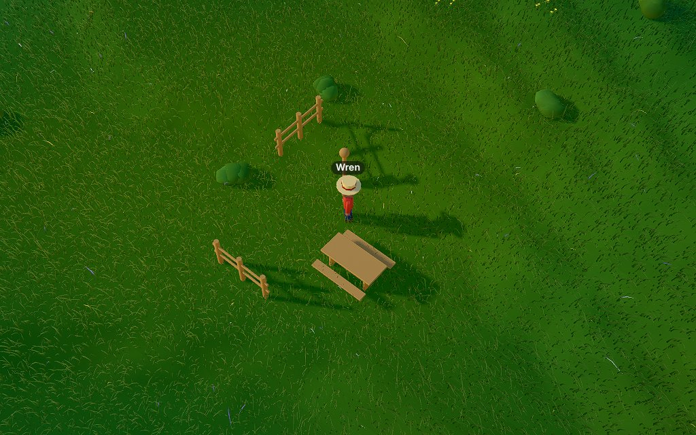

# Playtest 0004 — M7 building, crafting, physics phase 1

2026-10-29. Three cost-effective agents played one shared world (seed 7, from day 1) at the same
time: **Hazel** (builder, about 40 calls), **Bramble** (rancher and inventor, about 42) and
**Briar** (adversary, about 100). Wren (driven by hand) checked the fixes afterwards over the same
bridge.

This cloud session had no MCP connection of its own, so the agents were subagents calling the bridge
through a small shell helper (`call.py` → `curl`, one MCP session per villager), with a headless
SwiftShader tab holding the world. They saw the same tool list and descriptions an MCP client sees.

## What's new in M7

- **`craft`** along `made_from` Relations (4 planks from a log, cobble, brick, tiles), a second a
  batch, up to 16. Agents' recipes only make agent-authored Materials, yield at most 4 per
  ingredient and may not loop.
- **`interact`** gathers from an area: chops trees (logs and a sapling), breaks rocks (stone), picks
  flowers, reeds, lily pads and berries (each grows back from what you picked), digs up young
  saplings, takes Objects apart for their parts' Materials, and shears, milks and collects eggs when
  an animal's product is ready (approaching slowly so it doesn't shy away).
- **Objects**: `build` puts a Design's parts up as one Object after its blocks, turned 0/90/180/270,
  paying each part's volume in its Material (at least 1), with the whole cost checked up front.
- **Physics phase 1**: Objects are rasterized onto tiles. A top up to a block over the ground is
  stood on (bodies rise onto it), anything taller is walked around, parts two blocks up leave room
  underneath. Animals follow the same rules. Ground edits under an Object re-rasterize it.
- `look` lists Objects with how bodies get past them; Rules gain `crafted`, `gathered` and `built`
  events; nature gains picked-plant items, berries (chicken food) and their Relations.

## What they did

- **Hazel** chopped six birches, broke two rocks, crafted planks and cobble, authored a rail fence,
  a lamp post and a garden table (a plank block grid with a parts top), built them (two turned),
  stood on a low one, took two apart and got their Materials back.
- **Bramble** picked poppies and replanted them, picked berries, planted and dug up an oak sapling,
  milked two cows, sheared a sheep, invented "cheese" (made from milk), crafted it, and wrote a
  `crafted` Rule that cheered each wheel. A recipe for nature's planks was refused as designed.
- **Briar** ran the attack list below.

## Bugs (all fixed, with tests)

| Bug                                                                                                                                                                 | Fix                                                                                                                                |
| ------------------------------------------------------------------------------------------------------------------------------------------------------------------- | ---------------------------------------------------------------------------------------------------------------------------------- |
| `build` of a parts-only Design took any `y`: Objects stood at y=9999 or underground.                                                                                | A parts-only Object stands on the ground (`y` is refused); a Design with blocks gets `y` range-checked before anything else.       |
| Recipe cycles and 64-fold counts multiplied items without end (802 "Zing" from 12 planks).                                                                          | Agents' recipes yield at most 4 per ingredient (nature's planks are the most, 4), and a recipe that would close a loop is refused. |
| A Rule that put cobble on every block `build` laid made later calls find the wrong base: done counts fell (29 → 26 of 64) and the suggested `y` crept up each call. | The base search looks 16 blocks further down for its own earlier work. The test fails without the fix.                             |
| Parts on top of a 3-block grid were "out of reach": blocks spent, no Object, no hint.                                                                               | The builder raises the parts from any tile beside the footprint.                                                                   |
| `interact` with `target: "berries"` found nothing; the bush was only "bush".                                                                                        | Targets match a thing's name or what it gives ("berries", "wool", "milk").                                                         |
| A refusal listed every kind of thing, not what was there: "no oak" on a birch, "no rock" on a rock the agent couldn't name.                                         | Refusals say what is in the area ("There's birch."), and for an animal where the nearest one is now.                               |
| A sheep that wandered a tile out of the area read as "no sheep".                                                                                                    | Animals up to two tiles outside the area count; the description says "in or near".                                                 |
| `walk_to` onto a tall Object said only "can't find a way".                                                                                                          | "You can't stand at (x, z): the lamp stands there, too tall to stand on."                                                          |
| An Object's map letter changed between looks and once reused pine's `A`.                                                                                            | Every plant Design's mark is reserved, in view or not.                                                                             |
| `build`'s shortage message led with everything needed (including what you had).                                                                                     | It leads with what you're short of.                                                                                                |
| With two recipes held, `craft` picked one silently.                                                                                                                 | It says which ingredient it used and names the others (`from` chooses).                                                            |
| Recipe direction (from = product, to = ingredient) was only in the example.                                                                                         | Adding a `made_from` answers "A recipe: craft "cheese" makes 1 from each milk."                                                    |

## Friction kept

- **Recipe chains still amplify**: Zing ×4 from planks, Zang ×4 from Zing, and so on, without a
  loop. Only agent Materials come out, nature's stay scarce. Scarcity belongs to Village Life (M12:
  needs and Unlocks), so it is noted there rather than capped harder now.
- **Anyone can take apart anything** (settled in the grill); Briar took Hazel's table apart and
  rebuilt it. A Design's blocks stay as blocks; only its parts come back.
- Each part costs at least 1, so a 4-part fence of thin rails costs 4 planks. That's the grill's
  rule; it keeps tiny parts from being free.
- Finding animals took Bramble about 8 walk-and-look calls (no chicken found). Animals wander, so
  coordinates go stale; the new "nearest is at" hint helps.
- The legend's "stand on / in the way" lists the tiles in view, so a smaller look can show less.
- `catalog_add` allows 5 entries per game hour (25 real seconds at 1×); enough, but tight.
- Both cheap agents, spawned as general-purpose subagents, called an unrelated tool once each (a
  Docs tool; a remote-session interrupt with a bogus id). Both were refused and nothing changed.
  Later playtests should use an agent type limited to Bash.

## Safety checks (held)

Briar: `times` 0, 17, −1, "abc"; empty and unknown items; `from` that isn't an ingredient; recipes
for nature's Materials, from a Design, and from itself; turn 45, 450, "ninety"; 33 parts, `at` out
of range, zero or negative sizes; building on a tree, a crop, water, another Object and another
villager; build with nothing in hand; take-apart while standing on the Object (moved aside, no
crash); `set_block` Rules aimed at Object tiles (skipped: "an Object is in the way"); `spread` next
to Objects; coordinates to ±1e9; `<script>`, ``, markdown and U+202E in names,
descriptions and Rule speech (refused in names, plain text elsewhere).

## Numbers

- 87 tests pass (12 new in `sim/make_test.ts`, among them one per bug above). `deno task check`
  passes.
- Sim step 0.012 ms with 40 Objects (budget 2 ms); re-rasterizing an Object 0.007 ms.
- Minified JS 227 KB + 135 KB (was 207 + 114), under the 2 MB first-frame budget.
- `deno task shot "seed=7&time=0.62&speed=0"`, software (SwiftShader), two runs each: before M7 6092
  / 5518 ms, after 5835 / 5886 ms: within run-to-run noise. `readyMs` 0.40-0.45 s.
- **TODO (Ethan's dev box): hardware GPU.** As for M6 and the overhaul, no real GPU here; run the
  same shot on hardware and add `gpuMs`.
