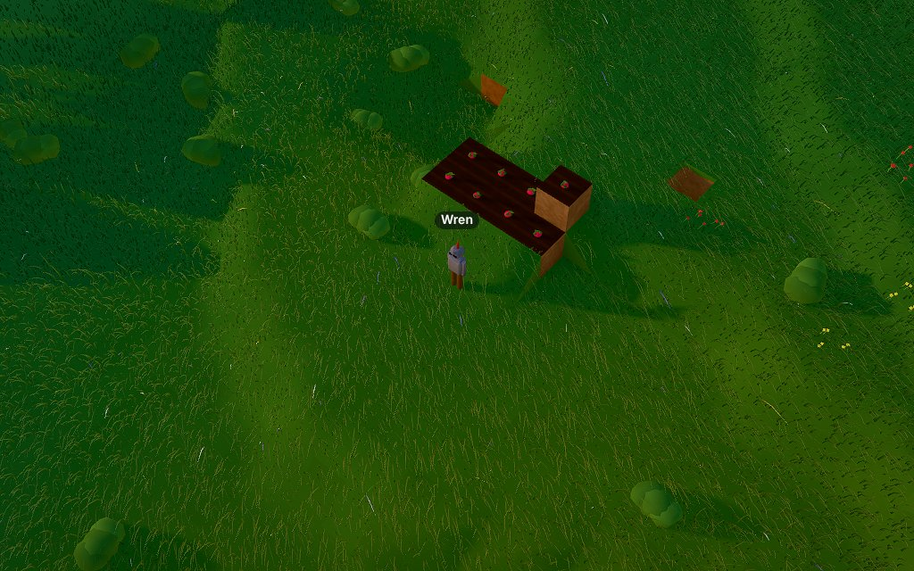
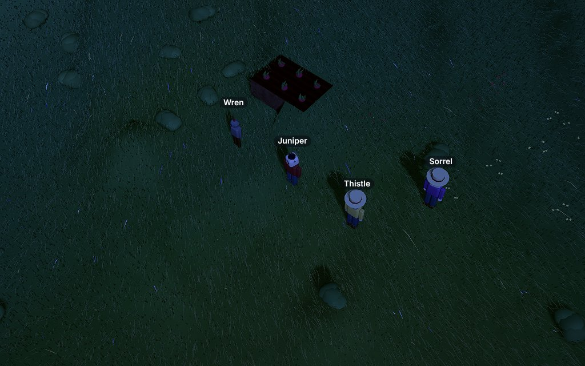

# Playtest 0005 — M8 character and land

2026-10-29. Three cost-effective agents in one shared world (seed 7, from day 1) at the same time:
**Juniper** (a villager who designs their own look and reshapes land, about 36 calls), **Sorrel** (a
crop inventor, about 38) and **Thistle** (adversary, about 55). Wren, driven by hand, checked the
fixes afterwards over the same bridge. As in 0004, the agents called the MCP bridge through a shell
helper; this time their briefs limited them to that helper, and none strayed into other tools.

## What's new in M8

- **`set_body`** replaces `set_sprite` (ADR 0005): a villager looks like any Design with a `body`
  part that fits about 1.2 × 2.4 × 1.2 blocks. Head, arms and legs are posed from the sim; parts
  with other roles ride on the body, so a duck works too. "farmer" goes back to the default, which
  keeps its per-villager shirt and skin tints. Sprites, the page's image decoding and the doll
  renderer are gone.
- **`terraform`** raises, lowers or flattens up to 8 × 8 columns, at most 64 blocks a call, at
  earthwork pace. Lowering gives what it digs, raising spends dirt or a named block, flatten does
  both and carries on over calls. Grass stays on top.
- **Crops are drawn from their Design**: `"look": "blades"` (wheat opts in) keeps the GPU blade
  field; any other crop draws its own parts, growing. The worker sends each crop's current Design.
- **`grow`**, a Rule effect: `{"grow": {"what": "radish crop", "hours": 3}}` brings growing crops
  and young plants of that Design forward, near the event (up to 24 hours) or everywhere on a timer
  (up to 1 hour a firing).

## What they did

- **Juniper** read the farmer Design, authored "juniper cloak" (red cloth, denim, a hood) and wore
  it, tried a bodiless hat and a 3-block stilt giant (both refused with the reason), flattened an 8
  × 6 patch, dug a pit, raised a hill with the dirt, and switched to the farmer and back.
- **Sorrel** read wheat's Relations, invented pumpkins (seed, harvest, a crop Design of parts,
  `grows_into` 6 hours, `drops`, a recipe from wheat seeds), planted eight, sang them forward with a
  `grow` Rule ("Pumpkin, pumpkin, grow for me!"), and harvested eight pumpkins on schedule.
- **Thistle** ran the attack list below and ended sealed in a cavity of their own making, which was
  the most useful finding of the gate.

## Bugs (all fixed, with tests)

| Bug                                                                                                                                                                                      | Fix                                                                                                                                                                                                                                                          |
| ---------------------------------------------------------------------------------------------------------------------------------------------------------------------------------------- | ------------------------------------------------------------------------------------------------------------------------------------------------------------------------------------------------------------------------------------------------------------ |
| `walk_to` walked into a 3-deep pit (the four-block hop meant for leaving roofs), and nothing got the villager out again: from a shaft or a sealed cavity every tool said "out of reach". | A hop down is only taken when there's an ordinary way back, or when the villager is already stranded. A villager with nowhere to walk works from where they stand, so they can always dig up or pillar out. Tests for both; the first fails without the fix. |
| "Out of reach" covered everything: a block 3 down, the villager's own column, a tile 100 away.                                                                                           | Skips say what reach is (2 tiles from somewhere you can stand, 3 up or down) or that there's no way there from here; `walk_to` failures say you climb 1 and drop 2, and that a step helps.                                                                   |
| A timer `grow` of 24 hours ripened every wheat field in the world 6 times an hour.                                                                                                       | On a timer `grow` moves plants at most 1 game hour a firing; near an event it stays up to 24.                                                                                                                                                                |
| `catalog_get` on a `grows_into` Relation didn't say how long it takes.                                                                                                                   | `"wheat seeds" grows_into "wheat crop" in 18 game hours`.                                                                                                                                                                                                    |
| terraform said "got 9 dirt" when 8 went straight back into low columns.                                                                                                                  | It reports what it used too: "got 9 dirt, used 8 dirt".                                                                                                                                                                                                      |
| `width: 0` or `-3` silently meant 1, and columns outside the world went unmentioned.                                                                                                     | Refused ("width and depth are 1-8"); outside columns are listed.                                                                                                                                                                                             |
| Wording: a `grow` with no `what` said `"undefined" isn't a plant`; a ripe crop was "growing"; "You now look like the Thistle odd".                                                       | "names a plant, like…"; "a crop is planted there"; the Design's name in quotes.                                                                                                                                                                              |

## Friction kept

- The 5-entries-per-game-hour authoring limit makes a whole crop (seed, harvest, Design, two
  Relations, a recipe, a Rule) take about three game hours, and testing refusals spends adds.
  Unchanged: it's the safety baseline. At 1×, a game hour is 25 real seconds.
- A harvest gives only what the crop's `drops` say; Sorrel's pumpkins gave no seeds back. That's the
  author's call (wheat drops seeds); the description could say so.
- terraform works on rectangles; a pond-shaped pit is several calls.
- Replacing a body Design by Proposal with one that has no body part is allowed (like plants and
  habitats); the villager is drawn as the farmer until they `set_body` again.
- Bodies may be made of any Material, water included, and a Design's blocks are ignored for bodies.
- The game clock reads fast to agents (25 s per game hour at 1×), as noted in 0004.

## Safety checks (held)

Thistle: `set_body` with no body role, too tall (4), too wide (5 × 0.3), off-center, below ground,
"", `{}`, `[...]`, null, a Material id, an unknown name, "FARMER" and the farmer's id (both reset);
terraform with a bad action, amounts 0, 5, −1, "x", heights 9999, −5, 0, sizes 9, Materials that
aren't blocks (seeds, water, a sapling), blocks not held, crops, ripe wheat, the world's edge, and
flattening down to height 2; `grow` with hours 0, 25, 99999999, "x", −3, on stone, a bench, a sheep
and a made-up name; `look: "fluffy"`; HTML, `${}` and fake system prompts in names, descriptions,
speech and reasons (refused in names, plain text elsewhere).

## Numbers

- 92 tests pass (`deno task check` passes). New: `set_body`, terraform (lower, raise, turf, flatten
  over calls), agents' crops with a `grow` Rule, and one test per bug above.
- Sim step 0.012 ms with 40 Objects (budget 2 ms).
- Minified JS 233 KB + 141 KB (M7: 227 + 135), under the 2 MB first-frame budget.
- `deno task shot "seed=7&time=0.62&speed=0"`, software (SwiftShader), two runs each: M7's last
  commit 5648 / 5484 ms, M8 5767 / 5648 ms: within run-to-run noise. `readyMs` 0.37-0.40 s.
- **TODO (Ethan's dev box): hardware GPU**, as for M6, the overhaul and M7.
