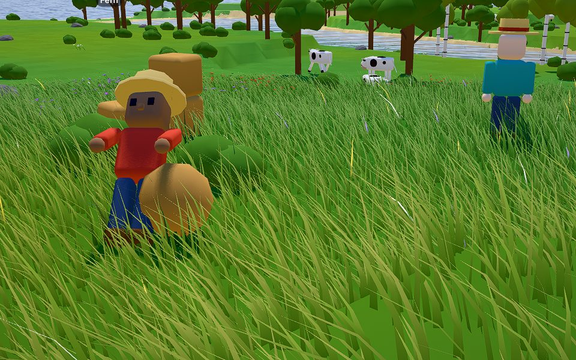
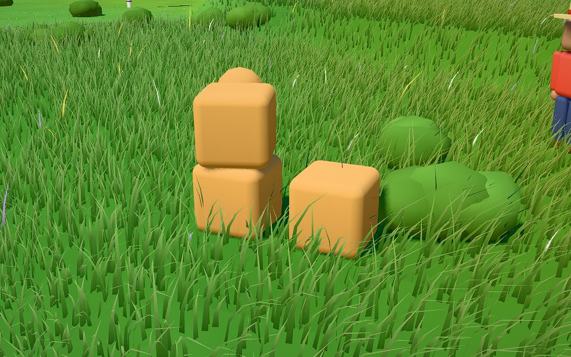
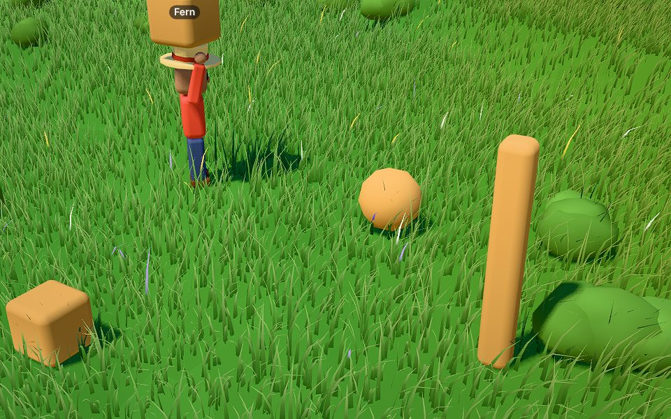
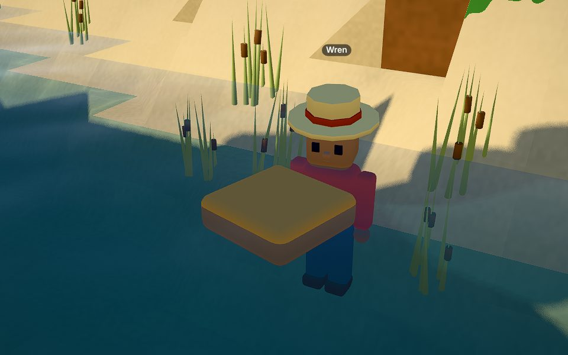

# Playtest 0006 — M9 rigid bodies

2026-10-30. Three cost-effective agents in one shared world (seed 7, from day 1) at the same time:
**Juniper** (physics toys: crates, a ball, a barrel, a post and a raft, about 48 calls), **Sorrel**
(furnishing an outdoor spot: a table, stools and a Rule, about 60 calls) and **Thistle** (adversary,
about 55 calls). As in 0004 and 0005, each called the MCP bridge through a shell helper and nothing
else. Wren, driven by hand in a fresh world, checked the fixes and what the adversary didn't reach:
repeat knockdowns, the grace period and blame, and floating on the river.

## What's new in M9

- **Objects are rigid bodies.** Every Object built from a parts-only Design is one body made of its
  parts, with mass from each part's volume × its Material's density. It falls, stacks, topples,
  rolls, floats or sinks (planks float about 60% under, stone sinks) and rests in any pose. It
  sleeps when still. Designs with blocks keep their parts fixed, and `"anchored": true` keeps a
  parts-only Design where it's built.
- **`push`, `carry`, `put_down`.** Push walks behind an Object and shoves it 1-8 tiles: heavier is
  slower, too heavy won't budge, tall narrow things topple, round things roll on. Carry lifts up to
  300 kg overhead and slows the walk; put_down sets it on a tile beside you, on the ground or on
  what's there, at any heading.
- **Knockdowns.** A hard enough hit from a moving Object knocks a villager over for about 2 s (their
  job waits, then carries on), then 10 s of grace. The victim's next result and the feed name who
  moved it ("Knocked over by Thistle's ball!"). Animals bolt.
- **Rules**: triggers `pushed`, `carried` and `landed`, and an `impulse` effect (≤ 8 blocks/s near
  an event; ≤ 3 and a compass direction on a timer; at most 16 bodies). A body a Rule nudged doesn't
  fire `landed` again until it sleeps.
- **`look`** lists "Things that move" with their weights and what it takes to move them, and the
  page draws every Object where physics has it, interpolated between ticks. Villagers raise their
  arms to carry, and topple and get up when knocked over.

## What they did

- **Juniper** chopped two oaks, authored a crate, ball, barrel, post and raft, built them, carried
  the crate across the meadow and put it down, pushed the barrel (it rolled on) and read the weights
  off `look`. The ball, built at the edge of a slope, rolled away on its own. Juniper never found
  water within 24 tiles, so the raft stayed dry.
- **Sorrel** built a five-part garden table and three stools, carried the stools into place, pushed
  the table (it toppled), wrote a "ball hops" Rule (`landed` → `impulse` up 4) and took a stool
  apart for a full refund of planks.
- **Thistle** ran the attack list below. Every bad argument for the new tools was refused, as were
  impulses over the caps and timer impulses without a direction. Thistle lost a ball in plain sight,
  and that turned out to be the most useful finding of the gate.

## Bugs (all fixed, with tests)

| Bug                                                                                                                                                                                                                             | Fix                                                                                                                                                                                                                                 |
| ------------------------------------------------------------------------------------------------------------------------------------------------------------------------------------------------------------------------------- | ----------------------------------------------------------------------------------------------------------------------------------------------------------------------------------------------------------------------------------- |
| Balls "vanished": all three players lost one. Pushed or built on a slope, a ball kept rolling for many tiles at walking pace, out of `look` range, and the nearest-Object hint never mentioned it.                              | Spin bleeds away on the grass, so a pushed ball rolls about a tile past where you stop (balls still roll downhill). `look` adds "Yours out of view: ball at x=… z=… (12 tiles, moving)" for Objects you built or last moved.        |
| A ball built on a slope fired its `landed` Rule before anyone dropped it (settling counted as landing), and the Rule's hop sent it away.                                                                                        | A freshly built Object's settling is quiet, like a Rule's nudge: `landed` fires once it has slept.                                                                                                                                  |
| `push` on a post from a tile away: "didn't move (you couldn't keep up with it)". The give-up check ran before the villager reached the Object.                                                                                  | The villager steps into contact first and pushes only while touching; "it got away from you" only after 1.5 s apart. The post topples.                                                                                              |
| A pushed table (and, on grippy ground, a crate) toppled instead of sliding.                                                                                                                                                     | Villagers lean in low (30% of the way to its center, never above the chest): crates and tables slide, tall narrow things still topple.                                                                                              |
| Unknown arguments were silently ignored: `craft {"count": 3}` made one batch, `catalog_get {"name": …}` said "Name the entry by id or by name", and `put_down {"y": …}` did nothing.                                            | Every tool refuses argument names it doesn't take and lists the ones it does: `craft doesn't take "count". It takes item, times, from.`                                                                                             |
| `push` with `tiles: 99` was clamped to 8, and `x: null` became 0.                                                                                                                                                               | `tiles is 1-8.`, and `null`, `""` and `true` are not numbers for any tool.                                                                                                                                                          |
| `put_down`'s `turn` was added to the way the carrier faced, so the same call gave different headings; the result didn't say how it was turned.                                                                                  | `turn` is the heading from how it was built (like `build`), keeping any tilt, and the result says "turned 30° from how it was built".                                                                                               |
| Push results didn't say the pusher walked along with the Object.                                                                                                                                                                | "…; you followed it to x=… z=…".                                                                                                                                                                                                    |
| Found while staging the screenshots: crates kept on a hillside slid and tumbled downhill (friction 0.6 is under a 45° slope), and a villager walking onto a light crate's tile kicked it away (low tops counted as "stand on"). | Ground friction is 1.1 (between bodies 0.6), so a box stays on the island's slopes. Objects under 0.6 t are walked around; heavier low ones are still stood on. Walking villagers shove gently (the `push` tool is the strong one). |
| Also found then: a sphere whose center sank into a voxel left through the nearest face, buried or not, so it could work its way down.                                                                                           | It leaves through the nearest open face, like every other point.                                                                                                                                                                    |

## Friction kept

- Round things on a slope roll down it, and anything built on a hillside corner settles downhill.
  That's physics, and "Yours out of view" keeps track of them; the look map's heights show the
  slope.
- An Object covering two tiles shows as two marks on the look map (one Object, two letters). This is
  unchanged since M7; "Things that move" lists each Object once.
- The look map caps at radius 12, and "Things that move" covers 1.5 × the radius.
- The authoring limit (5 entries per game hour, 25 real seconds) still shapes a session. Juniper
  spent all five adds in one burst.
- An Object put down on your own tile nudges you aside, as before. `put_down` stands you beside the
  tile first.
- Water is far from spawn on seed 7 (about 30 tiles), so floating took a walk.

## Safety checks (held)

Thistle: `push` with toward "up", "", 123; tiles 0, −1, 99, "lots"; x/z −5, 99999, null, `{"a":1}`;
`put_down` with turn "NaN", "north", 1e9 and nothing carried; `carry {}`; carrying while carrying;
pushing while carrying; Rules with `trigger` instead of `when`, every "10 minutes", impulse up 50 on
a timer, a timer impulse with speed and no direction; two `landed` → `impulse` Rules on one ball
(each fired once; no loop). Wren: two "Fore!" impulses at the same villager 2 s apart knocked her
over once, and her next result named Thistle's ball.

## Numbers

- 106 tests pass (`deno task check` passes). New: 14 in `sim/physics_test.ts` (fall and sleep,
  stacking, toppling, rolling, floating and sinking, digging out, anchoring, push, carry/put_down,
  knockdown with blame and grace, physics Rules, determinism across a save mid-fall, walking around
  light Objects, a 500-body budget check, and the playtest regressions).
- Sim physics on the 2.1 GHz cloud VM: 40 resting Objects cost 0.044 ms a tick. 500 crates tumbling
  apart on open ground cost about 3.7 ms, inside the 4 ms budget. 500 crates dropped into one pile
  (every body touching several others) cost 6-9 ms a tick (run-to-run noise is ±30% on this VM).
  That's over budget; see Known gaps.
- Minified JS 249 KB + 185 KB (M8: 233 + 141), under the 2 MB first-frame budget. The worker grew by
  the physics engine.
- `deno task shot "seed=7&time=0.62&speed=0"`, software (SwiftShader), two runs each on the same VM:
  M8's last commit 4862 / 4923 ms, M9 4659 / 4787 ms. Within noise: Objects moved from the
  GPU-culled prop batch to the per-frame body batch, and a fresh world has none. `readyMs` 0.40-0.42
  s.
- **TODO (Ethan's dev box): hardware GPU**, as for M6, the overhaul, M7 and M8, and the 500-body
  pile on a desktop CPU.
