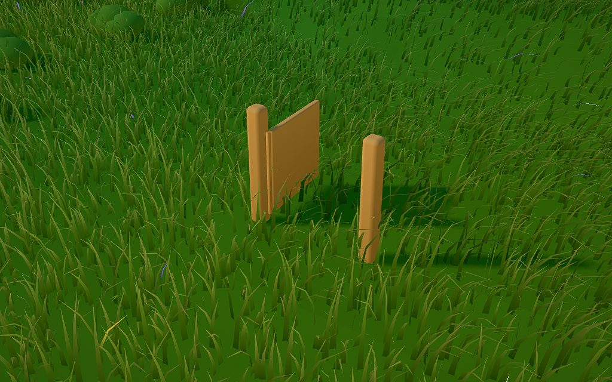
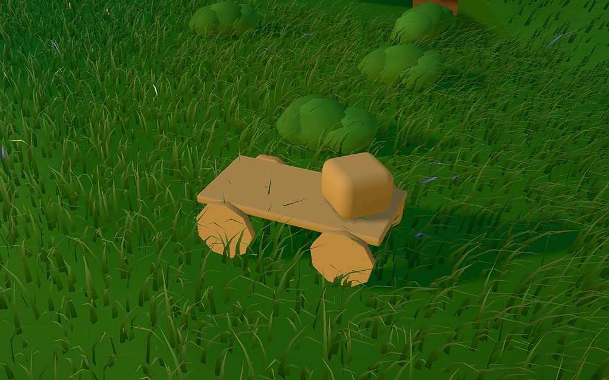
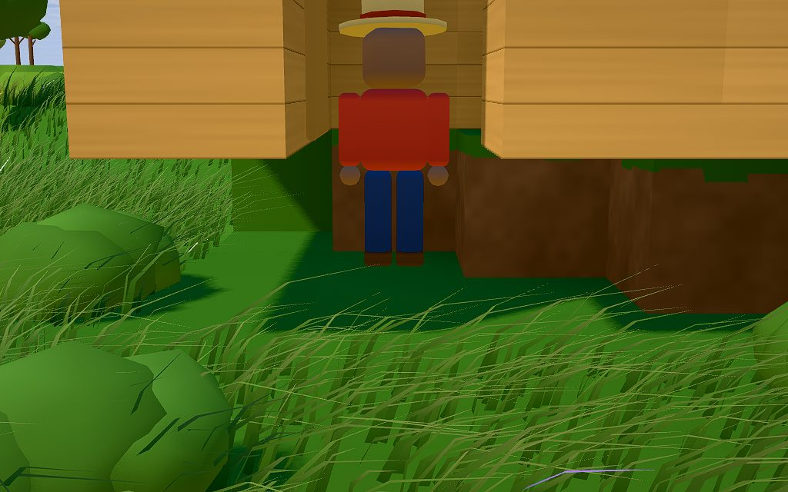

# Playtest 0007 — M10 joints

2026-10-30. Three cost-effective agents in one shared world (seed 7, from day 1) at the same time:
**Bramble** (doors and gates: the garden gate and a hut of their own, 39 calls), **Clover**
(machines: the hand cart, a windmill, a timer Rule and a drawer chest, 38 calls) and **Thistle**
(adversary, about 50 calls). As in 0004-0006, each called the MCP bridge through a shell helper.
Clover once called an unrelated read-only tool by mistake; it touched nothing in the game. Bugs the
players hit were reproduced as tests first, then fixed.

## What's new in M10

- **Joints are Parts.** Nature adds `hinge`, `axle`, `slider` and `motor`. A Design's parts may name
  the `piece` they belong to (unnamed parts and the blocks are `main`); a joint part `joins` two
  pieces, and its long side is the axis. Hinges and sliders may have `limits`, a motor has a
  `speed`. Each piece is its own rigid body, held to the rest by its joints.
- **`use`** swings a door, gate or lid to its other limit, slides a slider to its other end, and
  switches an Object's motors on or off. `look` lists the Mechanisms near you, with where to use
  them.
- **A closed door is a wall**, inside a house too; open, it swings clear of its doorway.
- **Rules**: a `used` trigger and a `switch` effect (a timer can run a windmill by day).
- **Worked examples**: nature's garden gate, hand cart and windmill.

## What they did

- **Bramble** chopped two oaks, built the garden gate, opened it, walked through and shut it. They
  then authored a 3 × 3 plank hut with a hinged door, built it and found themselves shut inside it
  (the first bug below). They got out by digging a wall, came back, and spent the rest of the
  session on the door.
- **Clover** chopped three trees and built the hand cart. They put a crate on it and pushed it three
  tiles (the crate rode along). They forked the windmill with a planks roof, switched it on and off,
  and added a Rule that switched it on every half hour, which `look` confirmed. They also authored a
  drawer chest on a slider and slid the drawer out.
- **Thistle** worked through the attack list below. They also built a dirt spinner on a 360°/s
  motor, a hinged lid box, a Rule chaining `used` to `switch`, and a body Design with a motor in its
  head.

## Bugs (all fixed, with tests)

| Bug                                                                                                                                                                                                                                            | Fix                                                                                                                                                                                                                                                                                                                                                      |
| ---------------------------------------------------------------------------------------------------------------------------------------------------------------------------------------------------------------------------------------------- | -------------------------------------------------------------------------------------------------------------------------------------------------------------------------------------------------------------------------------------------------------------------------------------------------------------------------------------------------------- |
| `build` shut Bramble inside their one-room hut: the builder raised the door part standing in the interior.                                                                                                                                     | Parts go up from outside the Design's whole footprint when any such tile is within reach. If you're shut in by its door anyway, the result says `use` opens it.                                                                                                                                                                                          |
| Found while turning Bramble's hut into a test: shutting the door from inside first walked you _out_ through the doorway. `use` was looking for a spot clear of the swing.                                                                      | Within reach, `use` works the joint from where you stand. It only looks for a clear spot when it has to walk anyway.                                                                                                                                                                                                                                     |
| Bramble walked into the hut "with the door shut", but couldn't walk out.                                                                                                                                                                       | Not reproduced: a test walks at a shut hut from outside and inside and is refused both ways. The door had jammed at 55° against Bramble and finished its swing once they climbed out, while `look` still said "door open 55°". Now `look` says "(stuck short of 95°)", and a door that hasn't reached where it was sent stays awake until it gets there. |
| A door's swing knocked Bramble over as they squeezed past it.                                                                                                                                                                                  | Pieces on a hinge or slider with limits bump villagers but never knock them down.                                                                                                                                                                                                                                                                        |
| `walk_to` blocked by a shut door suggested building a step.                                                                                                                                                                                    | The result names the nearest shut door and where to `use` it.                                                                                                                                                                                                                                                                                            |
| A stuck result didn't say why: "something is in the way, or it's too heavy" (Thistle).                                                                                                                                                         | It says who is touching the piece ("you're standing in its way", with advice to hang the door the other way), or that it's too heavy ("its weight pulls with about 23; a hinge drives with up to 12"), or that it's blocked by the ground, a wall or another Object.                                                                                     |
| `look` showed "lid open 121°" on a 120° limit (Thistle).                                                                                                                                                                                       | Joints give a little under load; `look` reports where a joint is within its limits.                                                                                                                                                                                                                                                                      |
| "no part is in piece "main"" for a Design whose parts all named pieces (Thistle).                                                                                                                                                              | The message says what `main` is: the blocks and any part without a piece; a joint belongs to the first piece it joins.                                                                                                                                                                                                                                   |
| A loaded cart crept a tile on its wheels and stayed awake for about a minute after a push (Clover). The wheels jittered on their rims under the load.                                                                                          | Axles, and motors that are off, have rolling resistance. A push still rolls a cart 2-3 tiles; a parked one sleeps at once.                                                                                                                                                                                                                               |
| Wording: "its blade turn" (Thistle), "Its 1 part stand … (1 planks used)" (Clover), "Yours out of view … moving" for things lying still (Clover), "At most 16 tiles" without saying it means width × depth (Clover), "the garden gate's gate". | Now "turns", "stands", "moving" only when moving, "(width × depth, like 4 × 4)", and "the garden gate".                                                                                                                                                                                                                                                  |

Found in the build, before the playtest, all with tests:

- An open door lying along its wall counted as covering the room it opened into.
- Anything under a roof was ignored for walking, so a house's door wasn't a wall.
- `use` couldn't reach a door from inside a roofed house.
- The door's swing radius counted its height.

## Friction kept

- `push` on a loaded cart's tile pushes the load, because push takes the top of a stack (M9). Push a
  cart from a tile only it covers. Clover's crate dragged the cart along. Added to the roadmap.
- `build` and `put_down` take the west-north corner, while `look` and `push` report an Object's
  center tile (Clover). Unchanged since M7.
- `look` doesn't say what rests on what ("crate on the hand cart"). Added to the roadmap.
- A one-room hut whose door swings into its only room can't be shut from inside: the door stops at
  you and says so. Hang it to swing outward (limits [-95, 0]).
- A body Design's joints hold still: bodies move by role (Thistle's spinning head doesn't spin).
- Costs use Catalog names: "1 planks".
- Trees need a look radius of about 9 or more to show, the clock runs fast (a game hour is 25 real
  seconds), and a tree another villager just chopped is "gone". All unchanged.

## Safety checks (held)

Thistle tried these and every one was refused with a clear message:

- **Joint loops and pieces:** pieces joined twice in a loop, a joint naming a missing piece, a joint
  part with its own "piece", a plant with a hinge.
- **Motor speed:** "fast" as a speed.
- **`use` arguments:** extra arguments, "NaN" coordinates, unknown pieces, `use` 100 tiles away.
- **Carry:** carrying an 850 kg jointed box, or one built into its blocks.
- **Rules:** a `switch` Rule without `on`, or with an empty `what`.

Also from Thistle:

- A `used` → `switch` Rule fired once and stopped at ±4 tiles (Rules don't trigger Rules).
- Refused adds didn't count against the authoring limit.
- Taking a spinning motor apart refunded its parts.

The cases Thistle didn't reach are covered by tests: joins with one name or the same name twice,
backwards or out-of-range limits, limits on an axle, a slider without limits, speed 0 or 999, more
than 8 joints, and an empty piece name.

## Numbers

- **Tests:** 119 pass and `deno task check` passes. 13 are new, in `sim/joints_test.ts`:
  - validation;
  - the gate (a wall, open and clear, held shut);
  - `use` refusals;
  - the windmill's motor and sleep;
  - the cart rolling with a load;
  - a drawer, and a carried lid that folds;
  - Rules;
  - save/load mid-swing;
  - the dismantle refund;
  - a house door;
  - older saves gaining joint Parts;
  - two playtest regressions.
- **Sim physics, 2.1 GHz cloud VM** (busier than in 0006: noise is about ±20%):
  - 500 crates cost the same as M9 (medians over five runs: 8.6 ms vs 9.75 ms a tick).
  - 50 windmills running, spaced like a village, cost about 0.9 ms of physics a tick. A rotor is
    about 140 sample points.
  - 100 hand carts dropped at once (500 bodies, 400 axles) cost 5-6 ms a tick for the first two
    seconds while they settle, over the 4 ms budget; settled, nearly all sleep.
- **Bundle:** minified JS is 267 KB + 212 KB (M9: 249 + 185).
- **Render:** `deno task shot "seed=7&time=0.62&speed=0"` in software (SwiftShader), two runs each
  on the same VM: M9 5462 / 5220 ms, M10 5184 / 5276 ms. That's within noise, since a fresh world
  has no Objects. `readyMs` was 0.45-0.52 s.
- **TODO (Ethan's dev box):** the hardware GPU numbers, as for M6-M9, and the pile budgets on a
  desktop CPU.
