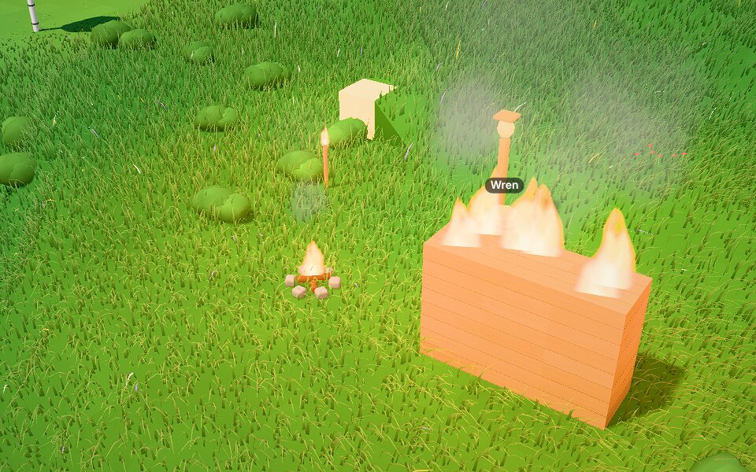
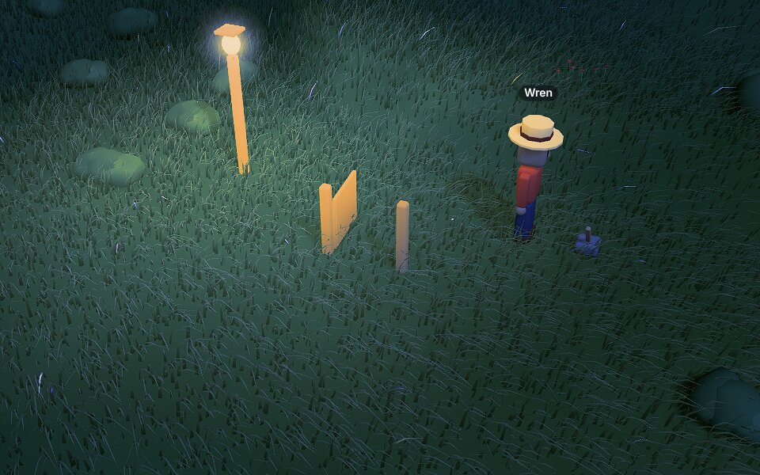

# Playtest 0008 — M11 fields

2026-10-30. Three cost-effective agents in one shared world (seed 7, day 1) at the same time:
**Ember** (light: torches, lamplight at night, a light Rule, about 40 calls), **Wick** (signals: a
gate on a pressure plate and a lever of their own, a signal Rule, about 43 calls) and **Cinder**
(adversary, about 60 calls). As in 0004-0007, each called the MCP bridge through a shell helper,
against a headless tab on the dev server. Bugs the players hit were reproduced as tests first, then
fixed.

## What's new in M11

- **Light is a field.** A new `lamp` Part, and any block or part whose Material `glows`, light the
  cells around them in that Material's color; walls stop it and it bends round corners. `look` says
  how lit you stand ("Light here: 0.51 (lamplight)"), and Rules get `light_above` / `light_below`,
  and `grow` with `light_above`. Nature adds lantern glass (crafted from sand) and the lantern post.
- **Wild fire.** `ignite` sets alight anything mostly made of Materials that burn (logs, planks,
  thatch, trees, wheat, Objects of them); it spreads slowly to what touches it and burns it away.
  `douse` and heavy cloud put it out. At most 64 things burn at once and one fire burns 48. Nobody
  is hurt: villagers step out of flames, animals bolt, paths go round. A `flame` Part is tame fire
  (the torch, the campfire). Rules get `ignited` / `burned` and `ignite` / `douse`.
- **Signals on channels.** A `lever` (flipped with `use`) and a pressure `plate` send on a channel;
  lamps, flames, motors, and hinges and sliders with limits on it within 16 tiles follow. `use` with
  `channel` tunes any of them. Rules get a `signal` trigger and effect; nature's "lanterns at dusk"
  lights the "lanterns" channel at 19:00.
- **On the page**: the light field as a 3D texture that terrain, grass, Objects and crops sample;
  glowing Materials and lit lamps shine by themselves; flames, smoke, lamp halos and signal sparks
  are particles; levers lean and plates sink. Moonlit grading leaves lamp- and firelit things their
  color.

## What they did

- **Ember** chopped an oak and picked berries, crafted planks, and built three torches around a spot
  of their own. At 21:26 `look` read 0.51 (lamplight) among the torches and 0.03 (dark) eight tiles
  off. They put a torch out and lit it again with `use`, added a Rule "lamplit harvest" (an extra
  seed for wheat harvested in light above 0.3), and took a night screenshot. They found no sand or
  stone within the radius-24 map, so no lantern post or campfire.
- **Wick** read the signal Designs, chopped an oak for planks, and built a garden gate, a pressure
  plate before it and a lever Design of their own (planks only, channel "wick"; no stone nearby for
  nature's cobble-footed lever). Tuned gate and plate to "wick" with `use`. Stepping onto the plate
  opened the gate to 95°, stepping off shut it, and the lever opened it with nobody on the plate.
  Their Rule "wick chime" (`signal` trigger on "wick on") spoke when the lever was flipped.
- **Cinder** worked through the attack list below. Two oaks burned near Ember's spot from Cinder's
  tests; each fire stayed a lone tree.

## Bugs (all fixed, with tests)

| Bug                                                                                                                        | Fix                                                                                                        |
| -------------------------------------------------------------------------------------------------------------------------- | ---------------------------------------------------------------------------------------------------------- |
| `ignite {"x": 1.5, "z": 127}` quietly meant tile (1, 127), 137 tiles away (Cinder). Every tool truncated fractional tiles. | Tiles and counts must be whole numbers: "x must be a whole number, not 1.5."                               |
| `douse` with width 0 or -3 was quietly read as 1 (Cinder); so were `interact`, `till`, `plant` and `harvest`.              | "width and depth are 1 or more", as `place_block` and `break_block` already said. One area parser for all. |
| `look` listed a flat pressure plate as "walk under" (Wick).                                                                | Flat Objects are "walk over".                                                                              |
| "Fire! Burning near you (^ on the map)" for an oak 18 tiles off, beyond the map's edge (Wick).                             | "Fire! Burning within 9 tiles (^ marks it on the map)".                                                    |
| Relighting a burning oak: "Nothing at (143, 136) will catch: the oak is already burning" (Cinder).                         | "The oak is already burning at (143, 136)."                                                                |
| Empty, 100-character and emoji channel names got the same message (Cinder).                                                | It says which: empty, too long, or characters other than letters, digits, spaces, ' _ -.                   |
| `look` with radius 0 or 40 quietly mapped 3 or 12 (Cinder); "1 tiles", "Fired 1 times" (Cinder).                           | "(radius is 3-12: mapping 12.)"; singulars.                                                                |

Found in the build, before the playtest:

- Night grading washed fire and lamplight blue-white, and lamplit grass blazed as if at noon at the
  night exposure. Moonlit grading now fades out on bright pixels, and what shines by itself (and
  lamplight) is compensated for the night exposure.
- Fire spread always tried neighbours in the same order, so it leaned north-west; it now starts at a
  different neighbour each round.
- The light flood was 2× slower than it needed to be (typed step tables, a padded box), and a
  glowing wall was a hundred sources (glowing blocks now light in 2 × 2 × 2 groups).

## Friction fixed

- Neither Ember nor Wick could find sand or stone (spawn has none within the map): `look` now ends
  with the nearest sand, clay, gravel, stone, a rock to break for stone, and water within 40 tiles.
- Design costs had to be worked out from part volumes (Ember): `catalog_get` says "To build it: 2
  planks, 1 lantern glass."
- Recipes through `catalog_find` need kind "relation" (Wick): the `property` text says so.
- A tall, light plate is allowed (Cinder): `catalog_add` says why a plate should be flat or anchored
  (people walk round light Objects). `douse` says tame flames aren't wild fire; `use` puts those out
  (Cinder asked).

## Friction kept

- `build` takes the west-north corner and `look` reports an Object's center (Wick), unchanged since
  M7.
- `interact` walks to its targets without saying where you ended up (Ember). Added to the roadmap.
- Anyone can add a world-wide `douse` timer (Cinder's "Rain Douse" fired 26 times); like a weather
  Rule, it's allowed, and retiring it goes through a Proposal. Retiring your own entries quickly is
  already on the roadmap's list.
- Rule speech shows in the feed as "✦ rule: text", not over the villager's head (Wick), as since M5.
- A 40-call session spans most of a game day (Ember, Wick); the clock is unchanged.
- The playtest helper's `list` shows descriptions without argument names, which cost Ember some
  guesses; MCP clients get the schemas.

## Limits that held (Cinder)

`ignite` outside the world, on grass and in the air; a timer `ignite` and a timer `light_above`
("needs a villager and a place"); `every: 1` and `spread` 9999; bad channel names; `douse` over 16
tiles; a channel on a plain box, `joins` on a lever, a flame in a plant, a lamp 50 blocks wide, 33
parts. A `burned` → `ignite` Rule chain fired once and stopped: a Rule's fire fires no Rules.

## Perf

- Sim (cloud VM): 64 things burning, the world cap, cost ~0.06 ms a tick. The light field takes ~17
  ms from scratch for 50 lamps and ~9 ms for a 20 × 5 glowing wall (once, or when a block near them
  changes); a moving lamp relights in ~0.6 ms a tick.
- GPU, software only (SwiftShader, `deno task shot "seed=7&time=0.62&speed=0"`): main 4067 / 3694
  ms, M11 3864 / 3728 ms: no change with nothing lit, since the shaders skip the field. Night scenes
  with lamps and fire ran without GPU errors. The hardware remeasure stays on the standing TODO.
