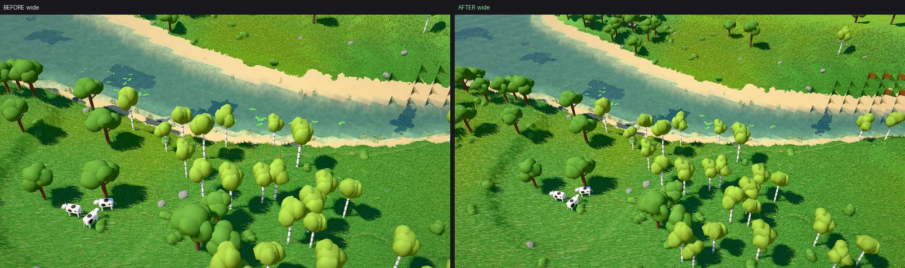
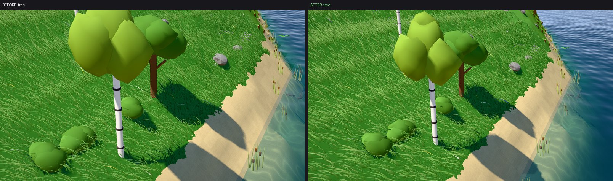
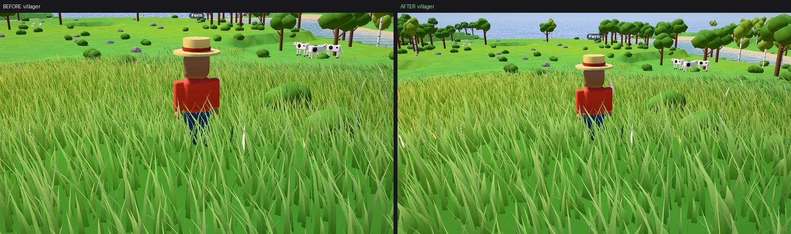
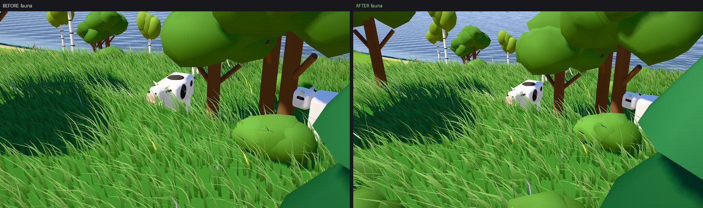
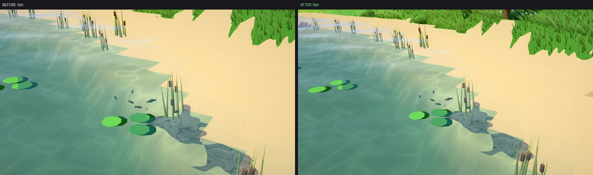

# Visual evidence — natural rendering polish

2026-11-07. A rendering-only pass over the Natural look, from issue #28. No gameplay, Catalog or sim
change: the deterministic tick, the tools and the save format are untouched. Captured on this cloud
VM under headless SwiftShader (seed 7, `time=0.42`, `speed=0`, `grass=1`, fixed scene time), so the
pictures are real and the milliseconds are CPU emulation — good for before/after, not for absolute
GPU cost.

## What changed

- **A wider spectator lens.** `fovY` 0.55 → 0.68 rad, so more of the village and meadow stays in
  frame without pulling away from it. Grass reaches the wider view with the original-density inner
  grid plus a sparse outer grid of wider blades; off-screen columns are rejected before their blades
  are hashed.
- **Richer bark and foliage.** Birch bark takes the `log` grain; oak and birch crowns are
  re-proportioned into irregular low-poly clumps with more per-vertex tone and lump noise. No
  texture assets and no extra geometry.
- **Less rigid motion.** Villagers counter-rotate the torso through the stride, lag the arms a
  fraction behind the hips, and steady the head; animals roll gently and swing a hinged tail; fish
  bodies and tails are separate templates, so the tail supplies the swimming stroke while the body
  follows the path.

## Before / after

Each pair is the same world, pose and scene time; left is `main`, right is this branch.

## Performance

Grass candidates are the cost that matters, and the two-tier grid bounds them:

|                     | candidates |
| ------------------- | ---------- |
| before (`main`)     | 430,336    |
| after (this branch) | 441,632    |

+2.6%. The near field keeps the original 64 blades per block; only the newly visible outer band is
sparse. `DESIGN.md` budgets ~600k blades at ~2.5 ms GPU on an RTX 2070 Super, so 441k leaves room.

Capture timings on this VM are dominated by host contention, so they are a range and not a
comparison. Run back-to-back under the same load, the same capture took 46.1 s (best) / 52.7 s
(median) on `main` and 51.1 s / 82.3 s here; across all sessions the same capture ranged from 2.2 s
to 90 s. The blade count above is the stable number.

## Verification

- `deno task check` — clean.
- `deno task test` — 226 pass. The one failure, `500 awake bodies stay inside the tick budget`, also
  fails on unmodified `main` on this VM (51–76 ms against a 40 ms budget), so it is a pre-existing
  environment limit rather than a regression.
- `__perf.gpuErrors` — empty on every capture.
