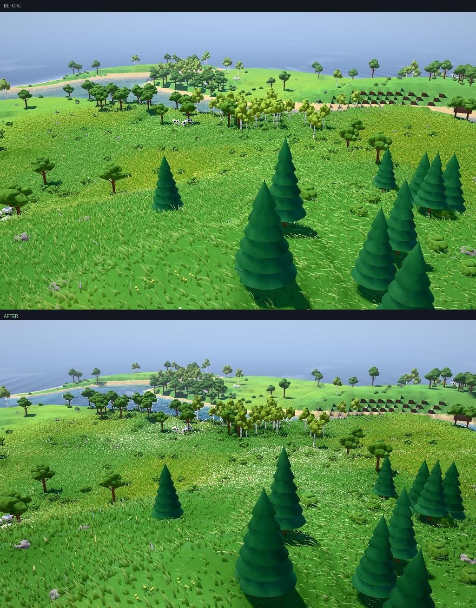
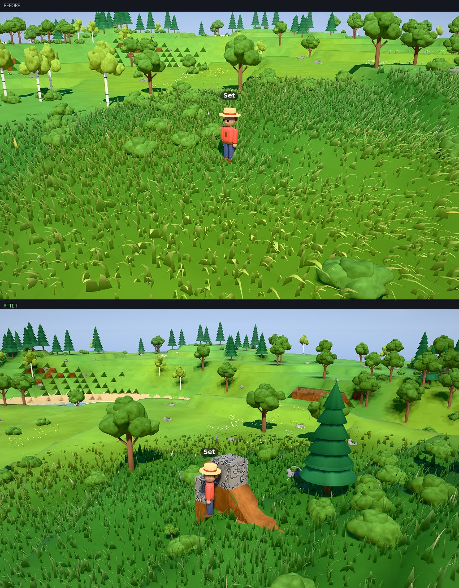
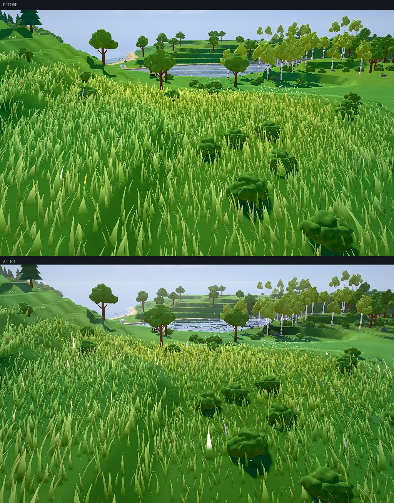
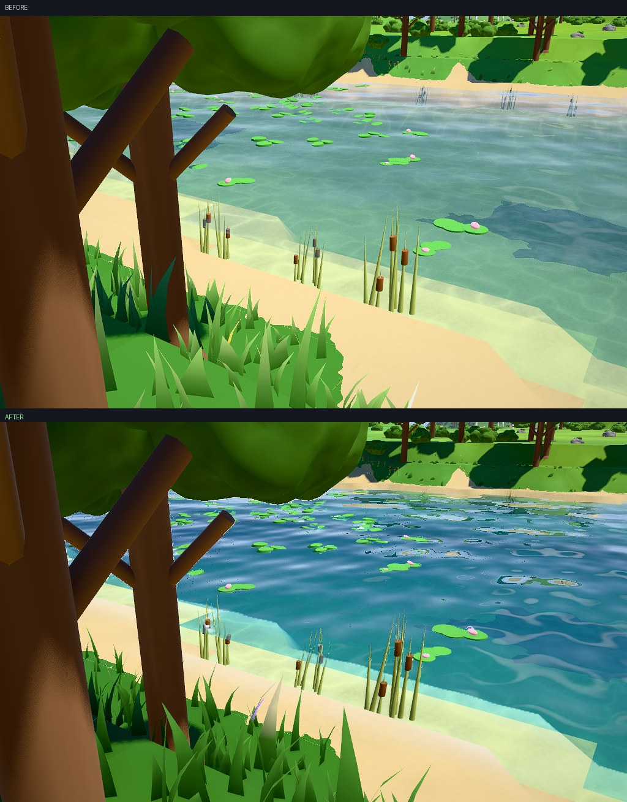
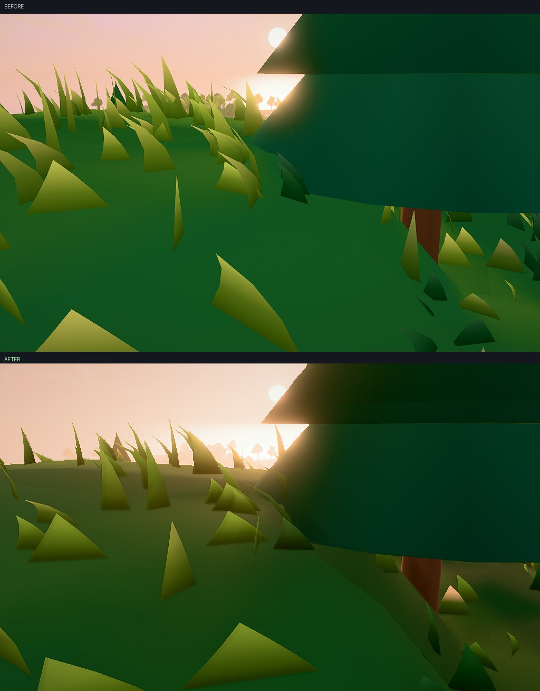
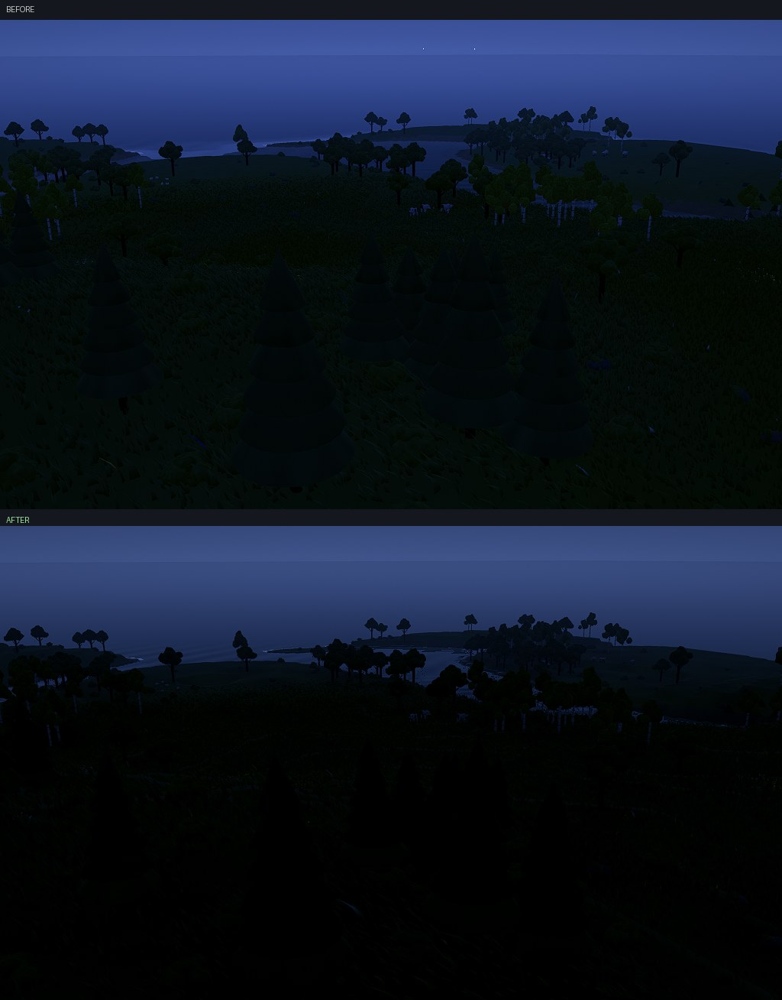
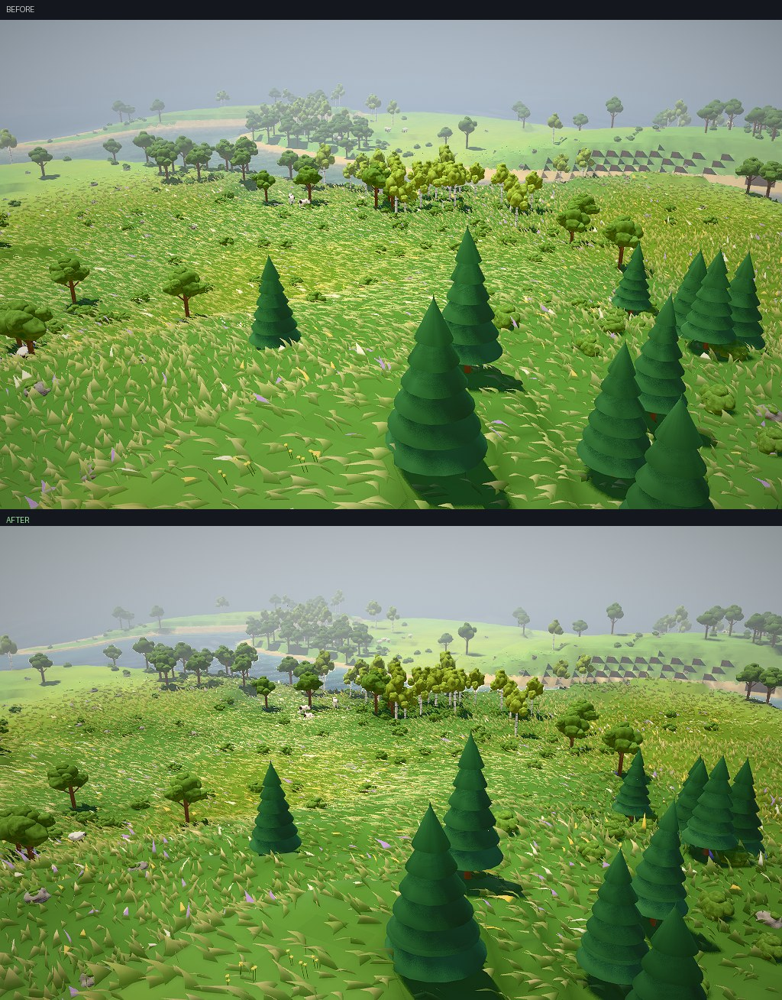

# Visual evidence — the visual overhaul

2026-11-16. The full twelve-phase rendering overhaul on `devin/1794868409-visual-overhaul`: a frame
with depth — grounded shade, shadows to the horizon, light shafts, water that refracts and mirrors,
surfaces that catch the sun, and an island that looks alive. Rendering only: `src/render/` plus a
little `main.ts`, `devpanel.ts` and `tools/`; no sim, Catalog or save changes (the deterministic
tick, the tools and SAVE_VERSION are untouched).

Captured on this cloud VM under headless SwiftShader (seed 7, `speed=1`, `quality=high`, fixed scene
time), so the pictures are real and the milliseconds are CPU emulation — good for before/after, not
for absolute GPU cost. The hardware frame-time check is Ethan's standing TODO.

## What changed, phase by phase

- **P0 Harness** — `tools/shotset.ts`: a whole set of named shots (pose + scene time + query) in one
  run, with `__perf` timings and `__perf.gpuErrors` into `report.json`; `?quality=` tiers
  (low/medium/high) the frame-rate governor can move between; a GPU timestamp query.
- **P1 Depth-aware frame** — the frame splits into an opaque `main` pass and a `trans` pass (medium+
  tiers), with the scene's depth and a half-res linear depth available to every consumer.
- **P2 Grounding** — a per-column field map (crown shade, shore proximity), villager/animal
  "pushers" that press the grass they walk through, and half-res GTAO multiplied into the ambient.
- **P3 Horizon shadows** — a second, wide shadow cascade (±260 blocks) so shade reaches the far
  fields instead of ending a few dozen blocks out.
- **P4 Air** — light shafts through the canopy against scene depth, and fog that follows the sky
  (horizon color, dusk, overcast) instead of a flat grey.
- **P5 Sky** — gradient sky with sun and moon discs, stars at night, drifting cloud layer that casts
  light-redducing cover onto the world. (A volumetric slab prototype behind `?clouds=volume` was
  prototyped and deferred — pending Ethan's pick against the 2D layer.)
- **P6 Water** — refraction of the scene color, screen-space reflections, shore foam, and waves.
- **P7 Surfaces** — per-Material roughness carried in the vertex stream; pattern relief (mortar,
  planks, tiles, furrows) via derivative bumping, specular sun glints and sky sheen, cliff strata,
  moss, and a livelier meadow floor.
- **P8 Vegetation** — grass blades with real normals (lit/shaded sides), clumping and dry patches,
  flowers and seed heads, gusts that lay blades over with a sheen.
- **P9 Life** — one instanced pass of purely shader-driven ambience: dust motes, butterflies, gulls,
  falling leaves, fireflies, moths — no CPU state, `?debug=life` skips it.
- **P10 Night** — moon-phase lighting: a full moon genuinely lights the island with distinct lit and
  shadowed sides; a new moon falls back to starlight.
- **P11 Post** — 13-tap Karis-weighted downsample and 9-tap tent upsample for bloom, and a per-look
  split-tone (cool shade / warm light) — off in Natural, on in Storybook.
- **P12 Wrap-up** — look tests cover bloom and split-tone channels; the spectator panel gains a
  quality selector (auto/low/medium/high, auto returns the tier to the governor); docs updated.

## Before / after

## Frame times (SwiftShader CPU emulation — ordering only)

| shot          | before mean ms | after mean ms |
| ------------- | -------------- | ------------- |
| noon-wide     | 21.9           | 25.1          |
| noon-horizon  | —              | 21.6          |
| morning-close | —              | 20.4          |
| dusk-into-sun | —              | 16.8          |
| night-moon    | —              | 16.7          |
| village       | —              | 16.8          |

The ~3 ms noon-wide rise buys the second cascade, GTAO, shafts, pattern bumping, the life pass and
the bigger bloom filter — the real GPU read is the hardware checklist below. `?debug=` accepts
`shadow,terrain,grass,water,sky,bodies,props,fire,bloom,depthdown,ao,shafts,life` for per-pass
profiling, and `__perf.gpuMs` reports GPU time where timestamps are supported.

## Known deviations and open questions

- **Soft-depth particles**: smoke and halo soft-fading against scene depth (`particles.ts`) was
  planned for Phase 9 and skipped — it needs a scene-depth binding that pass doesn't have yet.
- **`night-lamps` shot** needs a joined agent's lamps; uncapturable in a headless empty world.
- **Cloud slab** (`?clouds=volume`): prototype exists; needs Ethan's pick vs. the shipped 2D layer.
- **Tilt-shift DoF**: implemented nowhere yet; plan gates it on Ethan's say-so even for Storybook.
- **Hardware checklist for Ethan**: 60 fps on integrated GPU at `quality=auto` from noon-wide; GPU
  ms via `__perf.summary()`; compare low/medium/high on the real adapter.
